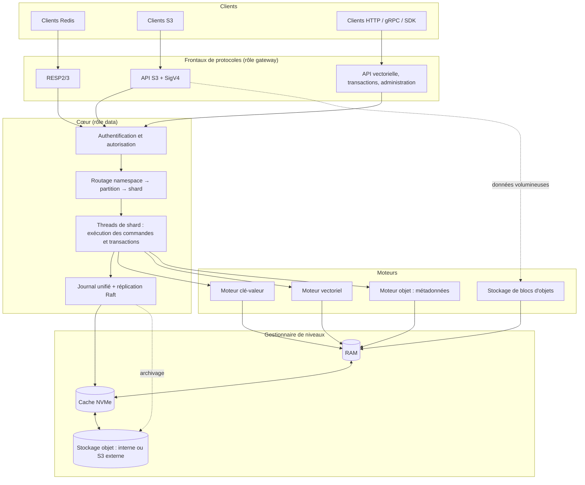
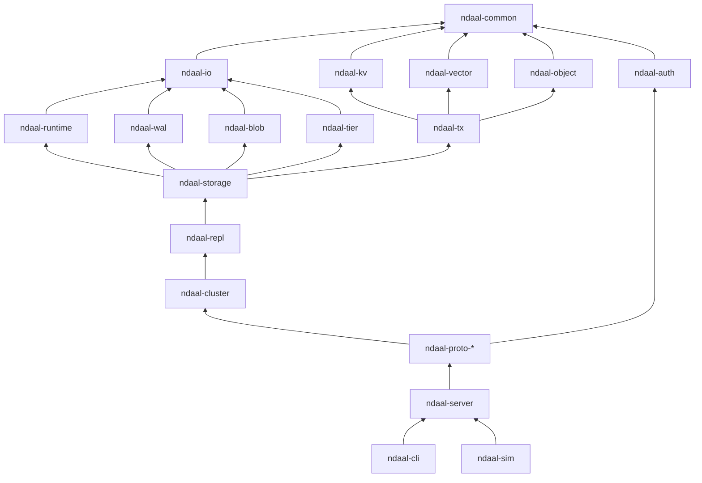
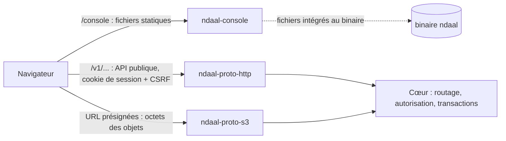
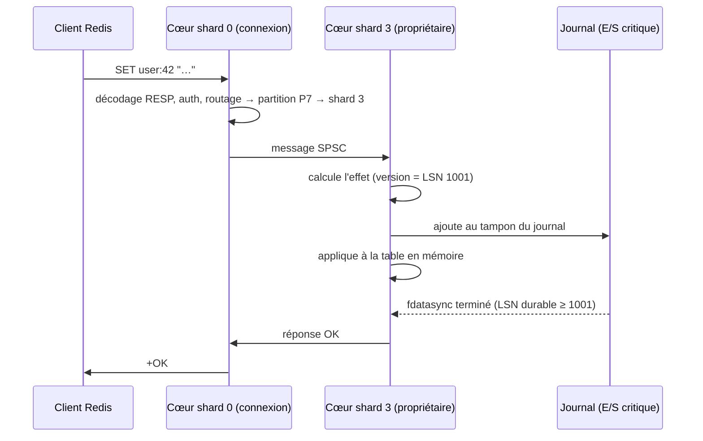
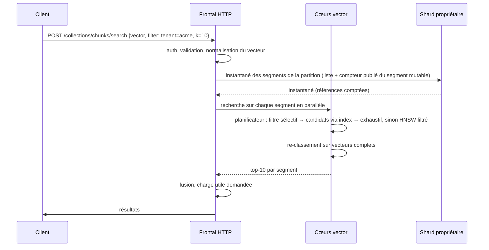
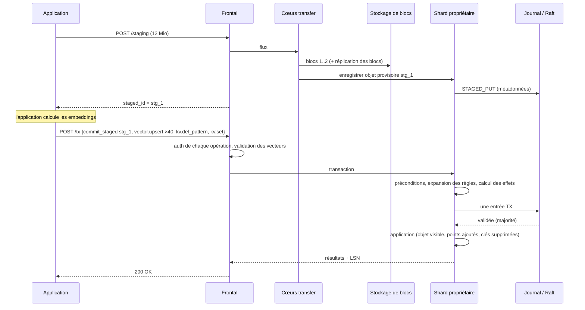

# Architecture — Ndaal

> Ce document décrit **comment** Ndaal est construit. Les besoins sont dans [CAHIER_DES_CHARGES.md](CAHIER_DES_CHARGES.md), les formats binaires dans [FORMATS_DE_DONNEES.md](FORMATS_DE_DONNEES.md), les justifications des choix dans [DECISIONS.md](DECISIONS.md).

## Sommaire

1. [Principes directeurs](#1-principes-directeurs)
2. [Vue d'ensemble](#2-vue-densemble)
3. [Organisation du code](#3-organisation-du-code)
4. [Modèle d'exécution](#4-modèle-dexécution)
5. [Espaces de noms, partitions et shards](#5-espaces-de-noms-partitions-et-shards)
6. [Journal unifié (WAL)](#6-journal-unifié-wal)
7. [Moteur clé-valeur](#7-moteur-clé-valeur)
8. [Moteur vectoriel](#8-moteur-vectoriel)
9. [Moteur objet](#9-moteur-objet)
10. [Transactions multi-modèles](#10-transactions-multi-modèles)
11. [Stockage par niveaux](#11-stockage-par-niveaux)
12. [Réplication](#12-réplication)
13. [Cluster et distribution](#13-cluster-et-distribution)
14. [Frontaux de protocoles](#14-frontaux-de-protocoles)
15. [Sécurité](#15-sécurité)
16. [Observabilité](#16-observabilité)
17. [Flux de bout en bout](#17-flux-de-bout-en-bout)
18. [Surcharge et gestion des erreurs](#18-surcharge-et-gestion-des-erreurs)
19. [Évolution et compatibilité](#19-évolution-et-compatibilité)
20. [Limites connues](#20-limites-connues)

---

## 1. Principes directeurs

| # | Principe | Conséquence |
|---|---|---|
| P1 | **Une hiérarchie, trois vues.** Cache, vecteurs et objets sont trois façons d'accéder à la même hiérarchie RAM → NVMe → stockage objet. | Un seul gestionnaire de niveaux, un seul cache de blocs, une seule politique de température. |
| P2 | **Un seul journal.** Toute modification, quel que soit le modèle, passe par le même journal (WAL). | Un seul mécanisme de durabilité, de réplication, de sauvegarde et de reprise. Atomicité multi-modèles naturelle. |
| P3 | **Un cœur possède ses données.** Chaque partition est possédée par un seul thread (un cœur). Pas de verrou partagé sur le chemin des écritures. | Sérialisabilité gratuite au sein d'une partition ; latence prévisible ; passage à l'échelle par ajout de cœurs. |
| P4 | **Les charges lourdes ne touchent jamais les cœurs du chemin court.** Calcul vectoriel, transferts d'objets et tâches de fond tournent sur des cœurs dédiés avec des priorités d'E/S. | Isolation (ENF-ISO). |
| P5 | **Les octets volumineux voyagent hors du journal.** Les données des objets sont écrites directement dans le stockage de blocs ; seule leur référence passe par le journal. | Le journal reste petit et rapide ; les transactions incluent des objets de plusieurs Gio. |
| P6 | **Immuable sur disque.** Tout ce qui est écrit sur disque (segments) est immuable ; seuls le journal et le manifeste évoluent. | Cache, réplication, envoi vers le stockage objet et sauvegarde simplifiés. |
| P7 | **Tout est vérifiable.** Chaque bloc porte une somme de contrôle ; chaque format porte une version ; chaque composant à effets de bord (temps, disque, réseau, aléa) est injectable. | Détection des corruptions ; simulation déterministe. |
| P8 | **Refuser plutôt que s'effondrer.** Toutes les files sont bornées ; au-delà, Ndaal répond « occupé ». | Mémoire bornée, comportement prévisible en surcharge. |
| P9 | **Nœud unique d'abord, cluster ensuite, même code.** Le mode nœud unique est un cluster d'un nœud avec réplication de facteur 1. | Pas de chemin de code à part pour le petit déploiement. |
| P10 | **Jamais plus lent que ce qu'on remplace.** Chaque chemin critique (clé-valeur, recherche vectorielle, transfert d'objets) est conçu et mesuré face à Valkey, Qdrant et MinIO, à durabilité égale ([ADR-027](DECISIONS.md#adr-027--parité-de-performance-avec-les-services-remplacés)). | Une unification qui coûte en performance est refusée ; les bancs comparatifs sont une porte bloquante (ENF-COMP). |

---

## 2. Vue d'ensemble

### 2.1 Couches



### 2.2 Composants

| Composant | Responsabilité | Crate |
|---|---|---|
| Frontal RESP | Décodage/encodage RESP2/3, état de connexion (`SELECT`, `MULTI`, abonnements), traduction en commandes internes | `ndaal-proto-resp` |
| Frontal S3 | Routage HTTP S3, vérification SigV4, flux de données, traduction en opérations objet | `ndaal-proto-s3` |
| Frontal HTTP/gRPC | API vectorielle, transactions, administration, santé, métriques | `ndaal-proto-http` |
| Authentification | Utilisateurs, clés, rôles, vérification des permissions | `ndaal-auth` |
| Routage | Table de partitions, résolution namespace/clé → partition → nœud/shard, redirections | `ndaal-cluster` |
| Exécution | Runtimes par cœur, messagerie inter-cœurs, classes de charge, admission | `ndaal-runtime` |
| Journal | Écriture groupée, lecture, reprise, troncature, archivage | `ndaal-wal` |
| Partition | Assemble journal + moteurs + manifeste ; applique les entrées ; points de contrôle | `ndaal-storage` |
| Moteurs | Clé-valeur, vecteurs, métadonnées objet | `ndaal-kv`, `ndaal-vector`, `ndaal-object` |
| Transactions | Modèle d'opérations, préconditions, règles d'invalidation et de cascade | `ndaal-tx` |
| Blocs d'objets | Stockage des octets des objets : local, externe, ou distribué avec codes d'effacement | `ndaal-blob` |
| Niveaux | Cache hybride RAM/NVMe, température, envoi et rapatriement depuis le stockage objet | `ndaal-tier` |
| Réplication | Intégration Raft (une instance par partition), envoi d'instantanés | `ndaal-repl` |
| Plan de contrôle | Appartenance au cluster, carte des partitions, placement, rééquilibrage | `ndaal-cluster` |

---

## 3. Organisation du code

Le dépôt est un *workspace* Cargo. Chaque crate a une responsabilité unique et des dépendances orientées vers le bas.

```
ndaal/
├── Cargo.toml                    # workspace, versions de dépendances centralisées
├── crates/
│   ├── ndaal-common/            # types partagés : identifiants, erreurs, configuration, octets
│   ├── ndaal-io/                # abstractions temps/disque/réseau/aléa + implémentations réelle et simulée
│   ├── ndaal-runtime/           # thread-per-core, shards, messagerie inter-cœurs, pools, admission
│   ├── ndaal-wal/               # journal : format, écriture groupée, lecture, reprise
│   ├── ndaal-kv/                # structures clé-valeur, expiration, éviction, SST
│   ├── ndaal-vector/            # HNSW, quantification, segments, filtres, index de charge utile, index disque
│   ├── ndaal-object/            # métadonnées objet, multipart, versions, cycle de vie
│   ├── ndaal-blob/              # stockage des octets d'objets : local, externe, distribué (Reed-Solomon)
│   ├── ndaal-tx/                # transactions multi-modèles, préconditions, règles
│   ├── ndaal-storage/           # partition, manifeste, segments, compactage, points de contrôle
│   ├── ndaal-tier/              # cache hybride, température, stockage objet comme fondation
│   ├── ndaal-repl/              # Raft (openraft), stockage du journal Raft, instantanés
│   ├── ndaal-cluster/           # plan de contrôle, appartenance, carte des partitions, rééquilibrage, routage
│   ├── ndaal-auth/              # utilisateurs, rôles, ACL, SigV4, jetons
│   ├── ndaal-rpc/               # protocole interne entre nœuds
│   ├── ndaal-proto-resp/        # frontal RESP
│   ├── ndaal-proto-s3/          # frontal S3
│   ├── ndaal-proto-http/        # API HTTP/gRPC : vecteurs, transactions, administration
│   ├── ndaal-console/           # console web : fichiers intégrés au binaire, sessions, en-têtes de sécurité
│   ├── ndaal-observe/           # métriques, traces, journaux
│   ├── ndaal-i18n/              # traductions Fluent et choix de la langue (CLI et console uniquement)
│   ├── ndaal-server/            # assemblage du serveur
│   ├── ndaal-cli/               # binaire `ndaal` : serveur, client, administration, sauvegarde, bench
│   ├── ndaal-client/            # SDK Rust
│   ├── ndaal-embedded/          # mode bibliothèque sans réseau
│   └── ndaal-sim/               # banc de simulation déterministe
├── console/                      # code de la console web (Svelte + TypeScript), construit en CI (ADR-031)
├── sdk/
│   ├── python/
│   └── typescript/
├── tests/
│   ├── compat-redis/             # suites de compatibilité avec de vrais clients Redis
│   ├── compat-s3/                # suites de compatibilité S3 (dont ceph/s3-tests)
│   └── e2e/                      # scénarios de bout en bout (application RAG de référence)
├── bench/                        # bancs d'essai reproductibles
├── deploy/
│   ├── docker/                   # Dockerfile, docker-compose (nœud unique, cluster de 3 nœuds, bancs comparatifs)
│   └── helm/
├── locales/                      # fichiers de traduction Fluent : en/, fr/
├── .github/workflows/            # CI/CD GitHub Actions (ADR-028)
└── docs/                         # cette documentation
```

### Graphe de dépendances (simplifié)



### Règles de code

- `#![forbid(unsafe_code)]` dans toutes les crates sauf `ndaal-io`, `ndaal-runtime`, `ndaal-vector` (noyaux SIMD) et `ndaal-wal` (tampons alignés). Chaque bloc `unsafe` porte un commentaire `// SAFETY:`.
- Aucune crate ne lit l'horloge, le disque, le réseau ou l'aléa directement : tout passe par `ndaal-io` (voir [ADR-017](DECISIONS.md)).
- Les erreurs sont typées par crate (`thiserror`) et converties en codes de protocole uniquement dans les frontaux.
- Aucun `panic!` sur une entrée réseau ou disque : toute donnée externe est validée.
- Le code propre à un système (Linux `io_uring`, `O_DIRECT`, épinglage des threads) est confiné à `ndaal-io` et `ndaal-runtime` derrière `#[cfg(target_os = "…")]`, avec un repli pour macOS et Windows (ADR-016). Les chemins sont manipulés avec `std::path`, jamais par concaténation de chaînes.
- Aucun texte destiné à un humain dans le code de la CLI ou de la console : tout passe par `ndaal-i18n` (ADR-029). Les protocoles, journaux et métriques restent en anglais.

---

## 4. Modèle d'exécution

### 4.1 Thread-per-core

Ndaal démarre **un thread par cœur alloué**, épinglé (`sched_setaffinity`). Chaque thread exécute son propre runtime asynchrone mono-thread (`tokio` en mode `current_thread`, voir [ADR-003](DECISIONS.md)). Il n'y a pas d'ordonnanceur à vol de tâches (*work stealing*) : une tâche reste sur son cœur.

Les cœurs sont répartis en **classes de charge** :

| Classe | Rôle | Exemples de travaux | Priorité d'E/S |
|---|---|---|---|
| `shard` | Possède des partitions. Exécute les commandes clé-valeur, les transactions, l'application des entrées du journal, les écritures de métadonnées objet et vectorielles. | `GET`, `SET`, `MULTI/EXEC`, validation de transaction | Haute |
| `vector` | Calcul vectoriel. | Recherche ANN, construction d'index, quantification, compactage de segments vectoriels | Moyenne |
| `transfer` | Flux d'octets volumineux. | Réception et envoi d'objets, sommes de contrôle, chiffrement, codes d'effacement | Basse (débit) |
| `background` | Maintenance. | Compactage SST, envoi vers le stockage objet, rattrapage de réplicas, nettoyage | Très basse |
| `io` | Exécution des E/S disque (si `io_uring` indisponible). | Lectures/écritures `pread`/`pwrite`, `fsync` | Selon la demande |

Répartition par défaut (modifiable par `runtime.cores.*`) :

| Cœurs disponibles | shard | vector | transfer | background | io |
|---|---|---|---|---|---|
| 2 | 1 | partagé avec shard (priorité basse) | partagé | partagé | 1 |
| 4 | 2 | 1 | partagé avec vector | partagé avec vector | 1 |
| 8 | 3 | 3 | 1 | partagé avec transfer | 1 |
| 16 | 6 | 6 | 2 | 1 | 1 |
| 64 | 20 | 32 | 6 | 4 | 2 |

Quand deux classes partagent un cœur, le runtime de ce cœur utilise deux files de tâches avec **priorité stricte et budget** : la classe prioritaire est toujours servie d'abord, la classe secondaire reçoit au minimum 10 % du temps pour éviter la famine.

### 4.2 Connexions et messagerie inter-cœurs

- Les sockets d'écoute utilisent `SO_REUSEPORT` : chaque cœur `shard` accepte ses propres connexions RESP. Les connexions S3 et HTTP sont acceptées par les cœurs `transfer` (S3) et `shard` (HTTP léger).
- Une connexion reste sur le cœur qui l'a acceptée. Si une commande concerne une partition possédée par un autre cœur, elle est **transmise par message** au cœur propriétaire puis la réponse revient.
- Chaque paire de cœurs dispose d'une **file SPSC** (un producteur, un consommateur) sans verrou, bornée. Un cœur vérifie ses files entrantes à chaque tour de boucle.
- Les commandes multi-clés touchant plusieurs partitions (`MGET` sur un espace de noms réparti) sont découpées, envoyées en parallèle, puis les réponses sont réassemblées dans l'ordre.

```
Cœur 0 (shard)            Cœur 3 (shard, propriétaire de la partition P7)
  connexion client
  GET user:42 ──► P7 ? ──── message SPSC ──────►  exécute GET sur P7
                                                         │
  réponse au client ◄──── message SPSC ◄─────────────────┘
```

### 4.3 Ordonnanceur d'E/S

Toutes les E/S disque passent par un **ordonnanceur par périphérique** (`ndaal-io::sched`) :

- une file par classe de priorité (`critique` pour le journal, `haute` pour les lectures du chemin court, `moyenne` pour le vectoriel, `basse` pour les transferts, `fond` pour le compactage) ;
- pondération : à chaque tour, la file `critique` est vidée, puis les autres reçoivent des parts proportionnelles (par défaut 50/25/15/10) ;
- **seau à jetons** par classe pour limiter la bande passante des tâches de fond (par défaut 30 % de la bande passante mesurée du disque, réduite automatiquement si la latence des E/S `haute` dépasse sa cible) ;
- profondeur de file bornée par périphérique pour éviter qu'une rafale d'écritures massives ne retarde une lecture urgente dans la file matérielle.

Deux implémentations ([ADR-016](DECISIONS.md)) :

1. **Pool de threads d'E/S** (`pread`/`pwrite`/`fdatasync`), disponible partout. C'est l'implémentation initiale.
2. **`io_uring`** (Linux ≥ 5.10), avec `O_DIRECT` pour les segments et le journal, et des tampons enregistrés. Activée automatiquement si disponible.

### 4.4 Admission et contre-pression

Chaque classe de charge a une **file d'admission bornée** (en nombre de requêtes et en octets). Quand une file est pleine :

| Protocole | Réponse |
|---|---|
| RESP | `-BUSY Ndaal is overloaded, retry later` |
| S3 | `503 SlowDown` |
| HTTP/gRPC | `429 Too Many Requests` / `RESOURCE_EXHAUSTED` avec en-tête `Retry-After` |

Les quotas par espace de noms (EF-SEC-04) sont vérifiés **avant** l'admission, avec des seaux à jetons par espace de noms, pour qu'un locataire bruyant ne remplisse pas les files communes.

### 4.5 Comptabilité mémoire

Un **comptable mémoire** global répartit `memory.limit` en budgets :

| Budget | Défaut | Contenu |
|---|---|---|
| `kv` | 40 % | Tables clé-valeur en RAM |
| `vector` | 35 % | Graphes HNSW, vecteurs quantifiés, segments mutables |
| `block_cache` | 15 % | Cache de blocs de segments (partie RAM du cache hybride) |
| `buffers` | 5 % | Tampons réseau, tampons du journal, tampons de transfert |
| `overhead` | 5 % | Métadonnées, structures internes |

Les budgets sont **souples** : un budget sous-utilisé prête sa marge aux autres, mais la récupère en priorité (par éviction chez l'emprunteur). La somme ne dépasse jamais la limite. Chaque allocation importante (segment, table, tampon) est enregistrée auprès du comptable ; les petites allocations sont estimées par échantillonnage.

---

## 5. Espaces de noms, partitions et shards

### 5.1 Hiérarchie

```
Cluster
 └── Espace de noms (namespace) « acme »
      ├── Clés (16 bases logiques 0–15 pour RESP SELECT)
      ├── Collections vectorielles : documents, memoires
      └── Compartiments S3 : acme-docs, acme-media

Placement physique :
 Espace de noms ──► Partition(s) ──► Groupe de réplication (Raft) ──► Nœuds
                         │
                         └── sur chaque nœud : possédée par un shard (un cœur)
```

### 5.2 Deux modes d'espace de noms

| Mode | Description | Transactions | Limite |
|---|---|---|---|
| `single` (défaut) | Tout l'espace de noms vit dans **une partition**. Plusieurs petits espaces de noms peuvent partager une partition. | Atomiques et sérialisables sur tout l'espace de noms | Débit d'écriture d'un cœur (~150 000 opérations/s), taille d'une partition (configurable, par défaut 256 Gio avant alerte) |
| `sharded` | L'espace de noms est réparti sur *N* partitions (*N* configurable, extensible par division). | Atomiques et sérialisables au sein d'un **groupe de cohérence** | Pas de limite pratique |

Un espace de noms peut passer de `single` à `sharded` en ligne : la partition est **divisée** (voir §13.5).

### 5.3 Routage dans un espace de noms réparti

La **clé de routage** détermine la partition :

| Modèle | Clé de routage |
|---|---|
| Clé-valeur | Le nom de la clé ; si elle contient une étiquette `{…}` (comme les *hash tags* de Redis Cluster), seule l'étiquette est utilisée. Exemple : `cache:{doc:42}:resume` → `doc:42`. |
| Objet | La clé de l'objet, avec la même règle d'étiquette. Exemple : `docs/{doc:42}/contrat.pdf` → `doc:42`. |
| Point vectoriel | Le champ `routing_key` de la requête s'il est fourni, sinon l'identifiant du point. |

`partition = jump_hash(xxh3(clé_de_routage), N)`.

Toutes les entités partageant la même clé de routage forment un **groupe de cohérence** et vivent dans la même partition : une transaction UC-01 sur `{doc:42}` reste locale.

Opérations transverses dans un espace réparti :

- **Recherche vectorielle** : diffusée à toutes les partitions de la collection (*scatter-gather*), fusion des top-K. Si la requête précise une `routing_key`, une seule partition est interrogée.
- **Listage S3** : fusion triée des listages de chaque partition (itérateurs fusionnés par tas), avec un jeton de continuation qui encode la position dans chaque partition.
- **`SCAN`** : le curseur encode l'index de partition et la position dans la partition.

### 5.4 Shards

Sur un nœud, chaque partition locale est assignée à **un cœur `shard`**, qui en est l'unique écrivain. L'assignation équilibre la charge mesurée (opérations/s et octets) et peut être modifiée à chaud par migration de partition entre cœurs (gel bref, transfert de propriété, reprise ; quelques millisecondes).

---

## 6. Journal unifié (WAL)

### 6.1 Rôle

Le journal est la **source de vérité** de toute modification. Une entrée validée dans le journal est durable (selon le mode de durabilité) et sera appliquée aux moteurs, y compris après une panne.

### 6.2 Organisation physique

- **Un flux de journal par shard** (par cœur), et non par partition : toutes les partitions d'un shard écrivent dans le même fichier séquentiel. Cela regroupe les `fsync` et transforme des milliers de petites écritures en quelques grandes écritures séquentielles ([ADR-004](DECISIONS.md)).
- Chaque entrée porte l'identifiant de sa partition et le **LSN de la partition** (séquence propre à chaque partition, indépendante du flux physique).
- Le flux est découpé en **fichiers de segment de journal** de 64 Mio. Un fichier est supprimé (ou archivé) quand toutes les partitions qui y ont des entrées ont un point de contrôle au-delà.
- En mode répliqué, le journal Raft de chaque partition est **stocké dans ce même flux** : il n'y a pas de double écriture (journal Raft + journal moteur).

Le format exact est dans [FORMATS_DE_DONNEES.md §2](FORMATS_DE_DONNEES.md#2-journal-wal).

### 6.3 Écriture groupée (*group commit*)

```
 commandes ──► tampon du journal (cœur shard) ──► déclencheur ──► écriture + fdatasync ──► acquittements
                                                  │
                                    taille ≥ 256 Kio  OU  délai ≥ 200 µs  OU  aucune autre commande en attente
```

- Le thread du shard ajoute les entrées à un tampon aligné. L'écriture et le `fdatasync` sont soumis à l'ordonnanceur d'E/S en classe **critique**, sans bloquer le thread du shard : celui-ci continue à traiter d'autres commandes et à remplir le tampon suivant (double tampon).
- Les réponses aux clients sont envoyées quand le LSN durable dépasse celui de leur entrée.

### 6.4 Modes de durabilité

| Mode | Acquittement envoyé quand… | Usage |
|---|---|---|
| `none` | La commande est appliquée en mémoire ; rien n'est journalisé | Cache pur, données reconstructibles |
| `async` (défaut pour le clé-valeur) | La commande est appliquée en mémoire et ajoutée au tampon ; vidage au plus tard toutes les 100 ms | Équivalent de Redis `appendfsync everysec`, plus resserré |
| `sync` (défaut pour vecteurs, objets et transactions) | L'entrée est sur disque (`fdatasync`) | Données qui ne doivent pas être perdues |
| `replicated` | L'entrée est sur disque sur une majorité de réplicas | Mode cluster |

Le mode est configurable par espace de noms, par préfixe de clé (EF-KV-12) et peut être exigé par requête (en-tête `x-ndaal-durability`, ou commande `NDAAL.DURABILITY` en RESP).

### 6.5 Journalisation logique idempotente

Les entrées du journal décrivent l'**effet** d'une commande, pas la commande brute :

- `INCR compteur` est journalisé comme `SET compteur = 43 (version 17)`.
- `LPUSH liste a` est journalisé comme `LIST_PUSH_LEFT liste [a] (version 9)` : pour les structures volumineuses, on journalise l'opération mais avec la **version de la clé** obtenue.
- `ZADD`, `HSET`… de même.

Chaque clé (et chaque point vectoriel, chaque objet) porte une **version** égale au LSN de sa dernière modification. Pendant la reprise, une entrée n'est appliquée que si la version stockée de l'élément est inférieure à celle de l'entrée. La reprise est donc **idempotente**, ce qui permet des points de contrôle « flous » (*fuzzy*) pris sans arrêter les écritures ([ADR-007](DECISIONS.md)).

### 6.6 Points de contrôle et reprise

1. Périodiquement (par défaut quand 1 Gio de journal s'est accumulé pour une partition, ou toutes les 10 minutes), la partition écrit ses données en mémoire dans des **segments** immuables (SST pour le clé-valeur, segments vectoriels, segments de métadonnées objet), en parcourant ses tables par tranches (pour ne pas bloquer le shard). Elle note le LSN de départ `L_debut`.
2. Quand tous les segments sont écrits, un nouveau **manifeste** est publié atomiquement (écriture dans un fichier temporaire, `fsync`, renommage, `fsync` du répertoire) avec `checkpoint_lsn = L_debut`.
3. Les fichiers de journal dont toutes les entrées sont antérieures au `checkpoint_lsn` de toutes leurs partitions deviennent supprimables (ou archivables pour la restauration à un instant donné).

Reprise au démarrage :

1. Lire le manifeste de chaque partition.
2. Charger les segments (ou les ouvrir en lecture paresseuse s'ils sont froids).
3. Rejouer le journal à partir de `checkpoint_lsn`, en appliquant les règles d'idempotence.
4. Toute entrée dont la somme de contrôle est invalide **à la fin** du journal est considérée comme une écriture interrompue et tronquée ; une entrée invalide **au milieu** est une corruption : la partition passe en état `corrompu` et, en cluster, se reconstruit depuis un réplica.

---

## 7. Moteur clé-valeur

### 7.1 Structures en mémoire

Chaque partition possède une table par base logique (0–15) :

- **Table principale** : `hashbrown::HashMap` avec clés stockées en `Bytes` compacts (clés courtes en ligne jusqu'à 23 octets, sans allocation).
- **Valeurs typées** avec encodages compacts, à la manière de Redis :

| Type | Encodage compact (petit) | Encodage complet (grand) | Seuil de bascule |
|---|---|---|---|
| Chaîne | Entier en ligne si numérique ; octets en ligne ≤ 23 octets | `Bytes` partagé | — |
| Hash | Liste plate de paires (*listpack*) | `HashMap` | 128 champs ou valeur > 64 octets |
| Liste | *listpack* | Liste de blocs (*quicklist*) | 128 éléments |
| Ensemble | Ensemble d'entiers trié / *listpack* | `HashSet` | 128 éléments |
| Ensemble trié | *listpack* trié | Liste à enjambements (*skiplist*) + `HashMap` membre→score | 128 éléments |
| Stream | — | Arbre radix de blocs | — |

- **En-tête par clé** (8 octets) : type, encodage, version (LSN tronqué, la version complète étant dans un tableau parallèle si nécessaire), compteur d'accès LFU (8 bits) et horodatage LRU (16 bits), drapeaux (volatile, lien, débordée).

### 7.2 Expiration

- Les échéances sont stockées dans une table séparée `clé → échéance` et dans une **roue temporelle hiérarchique** pour l'expiration active.
- **Expiration paresseuse** : toute lecture vérifie l'échéance ; une clé expirée est traitée comme absente (EF-KV-03) et supprimée.
- **Expiration active** : à chaque tour de boucle, le shard traite les créneaux échus de la roue dans un budget de temps (par défaut 1 ms par tranche de 100 ms).
- Les suppressions par expiration sont journalisées (`EXPIRE_DEL`) pour que les réplicas et la reprise convergent, avec l'horloge du leader comme référence.

### 7.3 Éviction

Quand le budget `kv` est atteint :

- politiques `*-lru`, `*-lfu`, `*-ttl`, `*-random` : **échantillonnage** (par défaut 16 clés) et éviction de la pire, comme Redis, avec un réservoir de candidats ;
- politique `tiered` : au lieu de supprimer, la clé froide est **déplacée vers le niveau NVMe** (§11). Elle reste lisible (latence plus élevée) ; un en-tête minimal reste en RAM si la table de résidence le permet, sinon seul le filtre de Bloom du segment la référence ;
- `noeviction` : les écritures reçoivent `-OOM`.

### 7.4 Données sur disque

- **SST clé-valeur** : segments triés par clé, blocs de 16 Kio compressés (LZ4 par défaut), index de blocs, filtre de Bloom (10 bits par clé), propriétés (plage de LSN, nombre de clés, plage d'échéances).
- Lecture d'une clé débordée : RAM manquée → filtres de Bloom des SST (du plus récent au plus ancien) → index de blocs → bloc (via le cache de blocs) → valeur. Après un nombre configurable d'accès, la clé est **promue** en RAM.
- Les valeurs de plus de 1 Mio (EF-KV-16) sont stockées hors ligne dans un segment de valeurs volumineuses ; la SST ne contient qu'une référence.

### 7.5 Opérations bloquantes et Pub/Sub

- `BLPOP` et similaires : le client est inscrit dans une file d'attente par clé sur le shard propriétaire ; toute écriture sur la clé réveille le premier client en attente.
- Pub/Sub : les canaux sont hachés vers un cœur « routeur pub/sub » ; un `PUBLISH` est transmis à ce cœur, qui diffuse aux cœurs possédant des abonnés. En cluster, diffusion entre nœuds via le plan de données interne. Pub/Sub n'est pas journalisé (comme Redis).

---

## 8. Moteur vectoriel

### 8.1 Modèle

```
Collection (dans un espace de noms)
 ├── configuration : vecteurs nommés {nom → dimension, métrique, type, index, quantification}
 ├── index de charge utile : {champ → type d'index}
 └── par partition :
      ├── segment mutable (écritures récentes)
      └── segments immuables (indexés)
```

### 8.2 Segments

**Segment mutable** (un par collection et par partition) :

- vecteurs stockés dans des **tableaux en ajout seul** par blocs de 4 096 points ; le nombre de points publiés est un compteur atomique, ce qui permet aux cœurs `vector` de lire sans verrou ce que le shard écrit ;
- suppressions et mises à jour : bitmap atomique de points supprimés ; une mise à jour = suppression logique + ajout ;
- petit index HNSW **incrémental** construit à la volée par un cœur `vector` dès que le segment dépasse 10 000 points ; en dessous, recherche exhaustive (plus rapide) ;
- charge utile stockée dans une table en mémoire de la partition, indexée par les index de charge utile mutables.

**Segment immuable** (produit par « gel » du segment mutable quand il atteint 200 000 points ou 64 Mio, ou par compactage) :

| Section | Contenu |
|---|---|
| Correspondance d'identifiants | identifiant externe (u64 ou UUID) ↔ position interne (u32) |
| Vecteurs complets | tableau contigu aligné, par vecteur nommé |
| Vecteurs quantifiés | int8, binaire ou codes PQ (+ livres de codes) |
| Graphe | listes d'adjacence HNSW par niveau (ou graphe Vamana pour l'index disque) |
| Bitmap de suppressions | `roaring` ; seule partie modifiable (en mémoire, journalisée) |
| Charge utile | stockage compact (JSON binaire) par position |
| Index de charge utile | mots-clés → bitmaps ; numériques → arbres d'intervalles / tableaux triés ; géo → geohash ; texte → index inversé |
| Statistiques | cardinalités par valeur indexée, histogrammes numériques |

La construction de l'index d'un segment immuable se fait **sur les cœurs `vector`** ; le segment n'est publié (ajouté à la liste des segments interrogés) qu'une fois complet. Jusque-là, ses points restent servis par le segment mutable gelé.

### 8.3 Index HNSW

Implémentation propre en Rust ([ADR-011](DECISIONS.md)) :

- paramètres `m` (par défaut 16), `ef_construct` (par défaut 100), `ef` de recherche (par défaut 64, ajustable par requête) ;
- distances en **SIMD** (AVX2, AVX-512, NEON) avec détection à l'exécution, et versions scalaires de repli ;
- construction parallèle sur plusieurs cœurs `vector` (insertion concurrente avec verrous fins par nœud du graphe, uniquement pendant la construction) ;
- recherche sur **vecteurs quantifiés** puis **re-classement** des `ef` meilleurs candidats avec les vecteurs complets (lus depuis la RAM ou le NVMe).

### 8.4 Recherche filtrée

Le **planificateur de requête** estime la cardinalité du filtre à partir des index de charge utile :

| Cardinalité estimée du filtre | Stratégie |
|---|---|
| < `full_scan_threshold` (par défaut 10 000 points par segment) | Évaluer le filtre via les index → liste de candidats → **recherche exhaustive** sur ces candidats (rappel parfait) |
| Intermédiaire | Parcours HNSW **avec le filtre appliqué pendant le parcours**, avec `ef` augmenté proportionnellement à la sélectivité |
| Élevée (filtre peu sélectif) | Parcours HNSW normal, filtrage des résultats, avec `ef` légèrement augmenté |

Pour les champs mots-clés à forte importance (par exemple `tenant_id`), l'index peut être construit avec des **liens supplémentaires par valeur** (sous-graphes par valeur reliés au graphe principal) afin que le parcours filtré reste connecté même pour des valeurs rares.

### 8.5 Index sur disque

Pour les collections plus grandes que la RAM (EF-VEC-13) :

- graphe **Vamana** (famille DiskANN) stocké sur NVMe, avec pour chaque nœud ses voisins et son vecteur complet dans le même bloc de 4 Kio (une lecture par saut) ;
- vecteurs **PQ** en RAM pour guider le parcours ;
- recherche en faisceau (*beam search*) avec lectures groupées en parallèle (profondeur de file NVMe exploitée) ;
- re-classement avec les vecteurs complets déjà lus.

### 8.6 Cohérence de lecture

- Par défaut (EF-VEC-15) : une recherche voit tous les points dont l'entrée est appliquée au moment où la recherche démarre sur le segment mutable (visibilité en quelques millisecondes en pratique, borne garantie de 1 s).
- `consistency=strong` : la recherche attend que le LSN appliqué de la partition atteigne le LSN de la dernière écriture connue du client (ou un LSN fourni).

### 8.7 Compactage vectoriel

Déclenché quand la proportion de points supprimés d'un segment dépasse 20 %, ou quand trop de petits segments coexistent : fusion de segments, reconstruction de l'index sur cœurs `vector` en priorité basse, publication atomique, suppression des anciens segments une fois qu'aucune recherche en cours ne les utilise (compteurs de références).

---

## 9. Moteur objet

### 9.1 Séparation métadonnées / données

```
                     ┌──────────────────────────────────────┐
PutObject ──► cœur   │ 1. flux des octets ──► stockage de    │
            transfer │    blocs (hors journal)               │
                     │ 2. calcul MD5/CRC/SHA à la volée      │
                     └──────────────┬───────────────────────┘
                                    │ référence des blocs + sommes
                                    ▼
                     ┌──────────────────────────────────────┐
              cœur   │ 3. entrée de journal OBJECT_COMMIT    │
              shard  │    (métadonnées seulement, ~200 o)    │
                     │ 4. index des métadonnées mis à jour   │
                     └──────────────────────────────────────┘
```

- Les **objets ≤ 64 Kio** (seuil configurable) sont stockés **en ligne** dans l'entrée du journal et dans le segment de métadonnées : une seule écriture, latence minimale.
- Les objets plus grands sont découpés en **blocs** de 8 Mio (configurable de 1 à 64 Mio) écrits dans le stockage de blocs par les cœurs `transfer`.

### 9.2 Index des métadonnées

Par partition, un **index ordonné** (arbre en mémoire pour la partie récente + SST pour la partie compactée) clé :

```
(identifiant de compartiment, clé de l'objet, version inversée) → métadonnées
```

Les métadonnées contiennent : taille, ETag, sommes de contrôle, type de contenu, en-têtes, métadonnées utilisateur, étiquettes, classe de stockage, liste des blocs (ou données en ligne), date de modification, version, état de verrouillage, liens (§10.5).

`ListObjectsV2` avec préfixe et délimiteur est un **parcours de plage** dans cet index ; les « préfixes communs » sont calculés en sautant directement à la clé suivant le préfixe commun (pas de parcours de tous les objets).

### 9.3 Stockage de blocs

Interface unique `BlobStore` avec trois implémentations :

| Implémentation | Usage | Description |
|---|---|---|
| `LocalBlobStore` | Nœud unique | Fichiers d'extension en ajout seul (*extent files*) de 1 Gio sur NVMe ; un bloc est une plage dans un fichier ; table d'allocation journalisée ; récupération de l'espace par compactage des fichiers d'extension |
| `ExternalBlobStore` | Mode désagrégé avec S3 externe | Un bloc = un objet chez le fournisseur externe, ou plusieurs petits blocs **regroupés** dans un objet « paquet » pour réduire le nombre de requêtes facturées |
| `DistributedBlobStore` | Cluster avec rôle `storage` | Chaque bloc est découpé en *k* fragments + *m* parités (Reed-Solomon), répartis sur *k+m* nœuds de stockage de domaines de panne différents (§13.6) |

Les blocs sont identifiés par un **identifiant de 128 bits** (partition, LSN de création, compteur) et sont immuables.

### 9.4 Multipart

- `CreateMultipartUpload` crée un enregistrement de téléversement (journalisé) avec une échéance.
- Chaque `UploadPart` écrit ses blocs hors journal puis journalise `PART_COMMIT` (numéro, taille, ETag, blocs).
- `CompleteMultipartUpload` vérifie la liste des parties, calcule l'ETag multipart et journalise un `OBJECT_COMMIT` qui **référence** les blocs des parties existants (aucune recopie).
- Les téléversements abandonnés expirent (par défaut 7 jours) et leurs blocs sont récupérés par le ramasse-miettes.

### 9.5 Ramasse-miettes des blocs

Un bloc peut devenir orphelin (objet supprimé, partie non utilisée, objet provisoire non validé, écriture interrompue). Ndaal utilise un **marquage-balayage** plutôt que des compteurs de références ([ADR-022](DECISIONS.md)) :

1. Périodiquement, chaque partition produit l'ensemble des blocs référencés (depuis ses métadonnées à un LSN donné), sous forme de filtre compact trié.
2. Le stockage de blocs compare avec les blocs existants **créés avant** une marge de sécurité (par défaut 24 h).
3. Les blocs non référencés et plus vieux que la marge sont supprimés.

La marge de sécurité couvre les écritures en cours et les objets provisoires valides (EF-TX-04).

### 9.6 Versionnement et cycle de vie

- Versionnement : chaque écriture crée une nouvelle entrée de version ; une suppression sans version crée un marqueur de suppression. La version courante est la première entrée (ordre de version inversé).
- Cycle de vie : un travail de fond par partition (classe `background`) évalue les règles quotidiennement et journalise les expirations et transitions comme des opérations ordinaires.

---

## 10. Transactions multi-modèles

### 10.1 Modèle

Une transaction est une **liste ordonnée d'opérations** et de **préconditions**, soumise en une fois (pas de transaction interactive avec allers-retours : cela évite de garder des verrous pendant les délais réseau du client).

```json
{
  "namespace": "acme",
  "preconditions": [
    { "type": "object_etag", "bucket": "acme-docs", "key": "{doc:42}/contrat.pdf", "absent": true }
  ],
  "operations": [
    { "op": "object.commit_staged", "bucket": "acme-docs", "key": "{doc:42}/contrat.pdf", "staged_id": "stg_01J…" },
    { "op": "vector.upsert", "collection": "chunks", "points": [ … ], "link": { "bucket": "acme-docs", "key": "{doc:42}/contrat.pdf" } },
    { "op": "kv.del_pattern", "pattern": "cache:recherche:*" },
    { "op": "kv.set", "key": "doc:{doc:42}:etat", "value": "indexe" }
  ]
}
```

### 10.2 Exécution sur une partition

1. Le frontal authentifie, vérifie les permissions de **chaque** opération, résout la partition (toutes les opérations doivent viser la même partition, sinon erreur `CROSS_PARTITION`).
2. Le message est envoyé au **shard propriétaire**. Le shard exécute la transaction **d'un seul tenant** (aucune autre commande de la partition ne s'intercale) :
   1. évaluation des préconditions ; si l'une échoue → réponse `PRECONDITION_FAILED` avec le détail, rien n'est écrit ;
   2. **expansion** des règles (§10.5, §10.6) : invalidations et cascades ajoutent des opérations dérivées ;
   3. calcul des effets (nouvelles valeurs, nouvelles versions) sans les appliquer ;
   4. écriture d'**une seule entrée** de journal `TX` contenant tous les effets ;
   5. application des effets aux moteurs ;
   6. acquittement après durabilité (mode `sync` ou `replicated` par défaut).
3. Comme l'entrée est unique et protégée par une somme de contrôle, la reprise applique **tout ou rien** (EF-TX-01).

Les opérations coûteuses sont préparées **avant** l'étape 2, hors du shard :

- les objets volumineux sont déjà téléversés (objets provisoires, §10.3) ;
- les vecteurs sont validés (dimension, type) et normalisés (pour la métrique cosinus) par le frontal ;
- le shard ne fait que des opérations en mémoire et une écriture de journal : une transaction typique UC-01 tient en quelques dizaines de microsecondes de temps de shard.

### 10.3 Objets provisoires

```
1. POST /v1/namespaces/acme/staging        → { "staged_id": "stg_01J…", "upload_url": "…" }
2. PUT  <upload_url> (ou multipart S3 sur le compartiment caché de préparation)
3. Transaction : object.commit_staged(staged_id → bucket/key)
```

- Un objet provisoire est un objet dont les blocs existent mais dont la métadonnée est dans une table de préparation avec une échéance (24 h par défaut, EF-TX-04).
- `commit_staged` déplace la métadonnée vers l'index réel : opération en mémoire, sans recopie d'octets.
- À l'échéance, la métadonnée provisoire est supprimée et les blocs deviennent orphelins (ramasse-miettes §9.5).

### 10.4 Isolation

- **Écritures** : sérialisables par construction (un seul écrivain par partition, exécution sans entrelacement).
- **Lectures dans une transaction** : les préconditions sont évaluées sur l'état courant au moment de l'exécution, donc cohérentes avec les écritures.
- **Lectures hors transaction** : lecture de l'état appliqué le plus récent (ou attente d'un LSN, EF-TX-09).
- **Recherches vectorielles** : elles s'exécutent sur les cœurs `vector` sur un instantané de segments ; elles voient un état cohérent **par segment** et un préfixe cohérent du journal pour le segment mutable (aucune transaction n'est vue « à moitié », car le compteur de points publiés n'avance qu'après application complète d'une entrée).

### 10.5 Liens et cascades

- Une opération `vector.upsert` ou `kv.set` peut déclarer un **lien** vers un objet (`link`).
- La partition maintient un **index inverse** `objet → {points, clés}`.
- La suppression d'un objet avec `cascade=true` (ou si la règle de compartiment `cascade_delete` est active) ajoute à la même transaction la suppression de tous les éléments liés (UC-03).
- Le nombre d'éléments en cascade est limité par la taille maximale de transaction ; au-delà, la cascade est découpée en transactions successives et un **état de suppression en cours** rend l'objet invisible immédiatement.

### 10.6 Règles d'invalidation déclaratives

Exemple de règle d'espace de noms (EF-TX-06) :

```toml
[[namespace.acme.invalidation]]
on        = ["collection:chunks", "bucket:acme-docs/prefix:docs/"]
delete    = ["cache:recherche:*"]
```

À chaque transaction ou opération simple touchant une source, les motifs sont ajoutés à la transaction. Pour éviter un parcours de toutes les clés, les motifs d'invalidation doivent avoir un **préfixe fixe** : la table clé-valeur maintient un **index de préfixes** pour les préfixes déclarés dans des règles, permettant une suppression en temps proportionnel au nombre de clés concernées.

### 10.7 Transactions via RESP

`MULTI` / `EXEC` / `WATCH` sont implémentés sur le même mécanisme : les commandes sont mises en file côté connexion, puis envoyées au shard comme une transaction. `WATCH` devient une précondition de version sur les clés surveillées. Les commandes ciblant plusieurs partitions dans un `MULTI` renvoient `-CROSSSLOT` (comportement de Redis Cluster).

### 10.8 Transactions multi-partitions (extension)

Les transactions entre groupes de cohérence d'un espace réparti sont **hors du périmètre essentiel**. Une extension future (souhaitable) utilisera une validation en deux phases avec **intentions** journalisées dans chaque partition et un coordinateur journalisé, en réutilisant le journal unifié. Elle n'est pas nécessaire aux cas d'usage de référence.

---

## 11. Stockage par niveaux

### 11.1 Niveaux

| Niveau | Support | Contenu typique | Latence d'accès |
|---|---|---|---|
| **RAM** | Mémoire du processus | Tables clé-valeur chaudes, graphes HNSW, vecteurs quantifiés, segments mutables, blocs de segments très lus | ~100 ns |
| **NVMe** | Disques locaux | Journal, segments récents, cache de blocs de segments, cache de blocs d'objets, index vectoriels disque | ~100 µs |
| **Objet** | `DistributedBlobStore` interne ou fournisseur S3 externe | Tous les segments (en mode désagrégé), archives du journal, blocs d'objets froids, instantanés | 10–100 ms |

### 11.2 Deux modes de fondation

| Mode | Source durable | Rôle du NVMe | Usage |
|---|---|---|---|
| `local` (défaut en nœud unique) | NVMe local (+ réplicas Raft en cluster) | Stockage principal | Simplicité, latence minimale, petits déploiements |
| `disaggregated` | Stockage objet | Journal récent + cache | Grands volumes, coût, reconstruction rapide de nœuds, élasticité |

En mode `disaggregated` :

1. Le journal est durable par réplication Raft sur NVMe (latence faible).
2. Chaque segment immuable produit (point de contrôle, compactage) est **envoyé au stockage objet** par la classe `background`, puis le manifeste (qui référence les segments par leur clé dans le stockage objet) y est envoyé aussi.
3. Les fichiers de journal sont **archivés** dans le stockage objet une fois couverts par un point de contrôle (restauration à un instant donné, EF-OPS-06).
4. Localement, les segments ne sont plus que du **cache** : ils peuvent être évincés et relus à la demande.
5. Un nœud neuf peut prendre en charge une partition en lisant le manifeste, en ouvrant les segments paresseusement et en rattrapant la fin du journal depuis les réplicas (EF-NIV-02).

### 11.3 Cache hybride

Un **cache hybride RAM + NVMe** unique (bibliothèque `foyer`, [ADR-021](DECISIONS.md)) sert :

- les blocs de SST clé-valeur ;
- les sections de segments vectoriels non épinglées ;
- les blocs d'objets (lecture d'objets populaires) ;
- les segments téléchargés depuis le stockage objet.

Politique d'admission : **filtre de fréquence** (TinyLFU) pour éviter qu'un parcours unique (gros téléchargement, `SCAN`) ne chasse les données réellement chaudes. Les lectures de type parcours (`ListObjects`, `SCAN`, compactage, sauvegarde) sont marquées « ne pas mettre en cache ».

### 11.4 Température

Chaque élément suivi (clé, section de segment, bloc d'objet) a une **température** estimée :

- compteur de fréquence logarithmique (8 bits) avec **décroissance** périodique ;
- esquisse Count-Min pour les éléments non résidents (pour décider d'une promotion sans suivre chaque élément individuellement).

Décisions :

| Événement | Action |
|---|---|
| Clé clé-valeur froide et budget `kv` plein | Débordement vers SST (politique `tiered`) |
| Clé débordée lue ≥ `promote_after` fois (par défaut 2) dans la fenêtre | Promotion en RAM |
| Section de segment vectoriel froide | Éviction du cache RAM (reste sur NVMe/objet) |
| Collection entière peu utilisée | Index basculé en mode disque (si configuré), vecteurs complets laissés hors RAM |
| Bloc d'objet non lu depuis `cold_after` (par défaut 7 jours) en mode `local` avec niveau objet configuré | Transition vers le stockage objet (règle de cycle de vie implicite) |

### 11.5 Règles de placement

Configurables par espace de noms, collection, préfixe de clé ou compartiment (EF-NIV-04) :

```toml
[[placement]]
match = { namespace = "acme", key_prefix = "session:" }
tier  = "ram"            # épinglé en RAM, jamais débordé

[[placement]]
match = { namespace = "acme", collection = "archives" }
tier  = "disk_index"     # index vectoriel sur disque

[[placement]]
match = { bucket = "acme-backups" }
tier  = "object"         # écrit directement dans le niveau objet, jamais mis en cache
```

---

## 12. Réplication

### 12.1 Raft par partition

- Chaque partition forme un **groupe Raft** (facteur 1, 3 ou 5) via la bibliothèque `openraft` ([ADR-008](DECISIONS.md)).
- Le **leader** de la partition est l'unique écrivain ; son shard propriétaire exécute les commandes comme en nœud unique, mais l'entrée de journal est **proposée à Raft** au lieu d'être simplement écrite.
- Le **stockage du journal Raft** est le journal unifié du shard (§6.2) : une entrée Raft *est* l'entrée du moteur, avec en plus le terme Raft.
- **Machine à états** : l'application d'une entrée validée aux moteurs (la même fonction qu'en reprise).

### 12.2 Optimisations

| Optimisation | Effet |
|---|---|
| Regroupement des battements de cœur par paire de nœuds | Des milliers de groupes Raft sans tempête de messages |
| Regroupement des entrées de plusieurs partitions vers le même suiveur dans un même message réseau | Moins d'appels système |
| Écriture locale du leader en parallèle de l'envoi aux suiveurs | La latence est max(disque local, aller-retour réseau + disque distant) et non leur somme |
| Groupes « endormis » (*quiescent*) sans battement quand aucune écriture | Coût nul pour les partitions inactives |
| Baux de leader (*leader lease*) | Lectures sur le leader sans aller-retour de quorum |

### 12.3 Lectures

| Mode | Garantie | Coût |
|---|---|---|
| `leader` (défaut) | Linéarisable (avec bail de leader) | Lecture locale sur le leader |
| `lsn` | Lecture d'au moins le LSN donné (lire ses écritures) sur n'importe quel réplica | Attente éventuelle du rattrapage |
| `follower` | Obsolescence bornée (par défaut 100 ms) | Lecture locale sur le réplica le plus proche |

### 12.4 Instantanés

Un suiveur trop en retard (journal tronqué) reçoit un **instantané** : le manifeste de la partition et ses segments (envoyés en flux par la classe `background`, ou téléchargés directement depuis le stockage objet en mode désagrégé), puis il rattrape le journal depuis le `checkpoint_lsn`.

### 12.5 Blocs d'objets et réplication

Les blocs d'objets ne passent **pas** par Raft (P5). Leur durabilité est assurée par le stockage de blocs lui-même :

- `LocalBlobStore` en cluster : le cœur `transfer` du leader écrit le bloc localement **et** l'envoie en parallèle aux réplicas de la partition (réplication de blocs) avant de proposer l'entrée `OBJECT_COMMIT` à Raft. L'entrée n'est proposée qu'après que la majorité a confirmé le bloc.
- `DistributedBlobStore` : le bloc est encodé et ses fragments écrits sur les nœuds de stockage ; l'entrée n'est proposée qu'après écriture d'au moins *k + 1* fragments (configurable), le reste étant complété en arrière-plan.
- `ExternalBlobStore` : la durabilité est celle du fournisseur.

---

## 13. Cluster et distribution

### 13.1 Plan de contrôle

Un **groupe Raft système** (3 ou 5 nœuds désignés, ou les premiers nœuds du cluster) héberge le **pilote de placement** ([ADR-023](DECISIONS.md)), qui détient :

- la liste des nœuds, leurs rôles, leurs étiquettes (zone, baie), leur état ;
- le catalogue : espaces de noms, collections, compartiments, utilisateurs, rôles, règles ;
- la **carte des partitions** : pour chaque partition, ses réplicas, son leader connu, sa plage (pour les espaces répartis) ;
- les opérations en cours (déplacements, divisions, réparations).

Le catalogue est lu très souvent : chaque nœud en garde une **copie locale** mise à jour par abonnement (flux de changements du groupe système), avec un numéro d'époque. Une requête routée avec une carte périmée reçoit une redirection et déclenche la mise à jour.

En nœud unique, le pilote de placement est intégré et local.

### 13.2 Rôles

| Rôle | Fonction | Ressources dominantes |
|---|---|---|
| `gateway` | Frontaux de protocoles, authentification, routage. Sans état. | CPU, réseau |
| `data` | Réplicas de partitions : journal, clé-valeur, métadonnées objet, segments mutables vectoriels | RAM, NVMe |
| `vector` | Recherche et construction d'index pour les segments vectoriels immuables ; lit les segments depuis le stockage objet ou les nœuds `data` | CPU, RAM |
| `storage` | Fragments du `DistributedBlobStore` | Disques de grande capacité |
| `control` | Membre du groupe Raft système | Peu de ressources |
| `all` | Tous les rôles (défaut) | — |

Exemples de topologies :

```
Petit :     1 nœud  [all]

Standard :  3 nœuds [all] sur 3 zones

Grand :     3 × [control, gateway]
            6 × [data]
            8 × [vector]        ← ajouter quand la recherche sature
           12 × [storage]       ← ajouter quand le disque manque
```

Avec des nœuds `vector` séparés, les segments vectoriels immuables sont **assignés** aux nœuds `vector` (avec réplication de lecture configurable) ; le nœud `data` leader conserve le segment mutable. Une recherche est envoyée aux nœuds `vector` détenant les segments immuables **et** au leader `data` pour le segment mutable, puis fusionnée.

### 13.3 Appartenance et détection de pannes

- Chaque nœud envoie un **battement de cœur** au pilote de placement (par défaut toutes les secondes) avec ses statistiques (charge, espace, santé des disques).
- Un nœud absent pendant `node_down_after` (par défaut 10 s) est marqué **suspect**, puis **hors service** après `node_dead_after` (par défaut 5 min), ce qui déclenche la re-réplication de ses partitions et la réparation de ses fragments.
- La détection de panne d'un **leader de partition** est faite par Raft lui-même (délai d'élection 1 à 2 s), indépendamment du pilote (ENF-DISPO-02).

### 13.4 Routage

```
requête ──► gateway (n'importe quel nœud)
             │ 1. namespace + clé de routage → partition (carte locale)
             │ 2. partition → leader (carte locale, peut être périmée)
             ▼
          nœud leader ──► shard propriétaire ──► réponse
             │
             └─ si ce nœud n'est plus leader : réponse NOT_LEADER(nouvel indice) → gateway réessaie et met sa carte à jour
```

Mode **Redis Cluster** optionnel : les 16 384 emplacements (*slots*) Redis sont projetés sur les partitions des espaces répartis ; `CLUSTER SLOTS` et `CLUSTER SHARDS` décrivent la topologie, et les erreurs `MOVED`/`ASK` permettent aux clients compatibles de s'adresser directement au bon nœud.

### 13.5 Rééquilibrage, déplacement et division

**Déplacement de réplica** (ajout de nœud, équilibrage) : ajout d'un apprenant Raft sur le nœud cible → instantané + rattrapage → promotion en votant → retrait de l'ancien réplica. Débit limité par la classe `background`.

**Transfert de leadership** : pour équilibrer les leaders entre nœuds (les écritures se concentrent sur les leaders).

**Division de partition** (espace de noms qui grossit, passage `single` → `sharded`) :

1. Le pilote décide de diviser *P* en *P1* et *P2* selon les plages de hachage.
2. Une entrée `SPLIT` est validée dans le journal de *P* : à partir de ce LSN, *P1* et *P2* existent logiquement, partageant les mêmes segments (références, pas de copie).
3. Les nouvelles écritures vont à *P1* ou *P2* ; les compactages ultérieurs réécrivent les segments séparément.
4. *P2* peut ensuite être déplacée vers d'autres nœuds.

**Fusion** de petites partitions : opération inverse, quand de nombreux petits espaces de noms sont dispersés.

### 13.6 Stockage de blocs distribué

- Les nœuds `storage` exposent un service de fragments (écriture, lecture, suppression, inventaire) via le protocole interne.
- Placement d'un bloc : hachage cohérent par **rendez-vous** (*rendezvous hashing*) sur les nœuds `storage`, avec contrainte de domaines de panne (au plus `m` fragments par zone, pour survivre à la perte d'une zone si possible).
- Lecture : lecture des *k* fragments de données (pas de décodage si tous présents) ; sinon lecture de *k* fragments quelconques et décodage.
- **Réparation** : un processus de fond parcourt l'inventaire, détecte les fragments manquants ou corrompus (sommes de contrôle) et les reconstruit sur d'autres nœuds.
- **Vérification** (*scrubbing*) : relecture périodique de tous les fragments (par défaut une fois par mois, débit limité).

---

## 14. Frontaux de protocoles

### 14.1 RESP

- Décodeur incrémental sans copie (sur `bytes::BytesMut`), limites strictes : taille d'une commande (par défaut 512 Mio), nombre d'arguments (par défaut 1 M), longueur des lignes en ligne (64 Kio).
- **Pipelining** : toutes les commandes reçues dans un tampon sont décodées et envoyées ; les réponses sont renvoyées dans l'ordre, regroupées en une seule écriture réseau.
- Table de commandes générée : nom, arité, drapeaux (lecture/écriture/admin/bloquante), position des clés (pour le routage), fonction d'exécution. `COMMAND DOCS` en est dérivé.
- Commandes propres à Ndaal, préfixées `NDAAL.` : `NDAAL.NS <espace>` (choisir l'espace de noms de la connexion), `NDAAL.DURABILITY`, `NDAAL.WAITLSN`, `NDAAL.TX` (transaction multi-modèles en JSON), `NDAAL.VSEARCH` (recherche vectorielle simplifiée).

### 14.2 S3

- Couche protocolaire basée sur la crate `s3s` ([ADR-013](DECISIONS.md)) : types S3, routage des opérations, analyse XML, vérification SigV4.
- Les corps de requête sont traités **en flux** sur les cœurs `transfer` : jamais d'objet entier en mémoire. Les sommes de contrôle sont calculées pendant le flux.
- Un compartiment est **global** au cluster (unicité du nom, comme S3) et appartient à un espace de noms.
- Lecture : `GetObject` sert les blocs depuis le cache, le NVMe ou le niveau objet, avec **lecture anticipée** des blocs suivants pour les lectures séquentielles.

### 14.3 HTTP et gRPC

- HTTP/1.1 et HTTP/2 (`hyper`, `axum`), JSON (`serde_json`) ; gRPC (`tonic`) avec les mêmes services.
- Points d'accès : API vectorielle, API transactionnelle, objets provisoires, administration, santé, métriques. Détail dans [API_ET_PROTOCOLES.md](API_ET_PROTOCOLES.md).

### 14.4 Console web

Console embarquée servie par chaque nœud sur le port HTTP, au chemin `/console` (EF-OPS-11, EF-OPS-14, ENF-UI, [ADR-031](DECISIONS.md#adr-031--console-web-embarquée-en-svelte-et-typescript)).



- **Code** : application Svelte + TypeScript dans `console/`, compilée en fichiers statiques par la CI. Les fichiers sont **intégrés au binaire** (`rust-embed`) par `ndaal-console` lorsque la fonctionnalité Cargo `console` est active ; sans elle, le serveur affiche une page « console non incluse » et se construit sans Node.js.
- **Aucun accès privilégié** : la console n'appelle que l'API HTTP publique ([API §8.1](API_ET_PROTOCOLES.md#81-points-daccès-pour-la-console-et-les-outils-interactifs)), avec les mêmes autorisations qu'un script. Les octets des objets passent par des URL présignées, directement vers le frontal S3, sans transiter par la console.
- **Sessions** : `POST /v1/auth/session` délivre un cookie de session protégé et un jeton anti-CSRF ; la session est liée à l'utilisateur et expire après inactivité. Les jetons porteurs restent réservés aux scripts.
- **Sécurité** : `ndaal-console` ajoute à chaque réponse les en-têtes CSP stricte, `X-Frame-Options: DENY`, `Referrer-Policy: no-referrer`, `X-Content-Type-Options: nosniff`.
- **Traductions** : les fichiers Fluent `locales/<langue>/*.ftl` sont partagés avec la CLI et chargés côté navigateur par `@fluent/bundle` (ADR-029).
- **Isolation** : la console est servie par les cœurs `gateway` ; une console ouverte ne consomme rien sur les cœurs `shard`, en dehors des requêtes API qu'elle émet, soumises à l'admission comme les autres.
- **Désactivation** : `console.enabled = false` coupe le chemin `/console` ; l'API reste disponible.

### 14.5 Protocole interne

Protocole binaire léger entre nœuds ([ADR-014](DECISIONS.md)) : trames `longueur | type | identifiant de requête | charge utile (postcard)`, multiplexées sur des connexions TCP persistantes protégées par mTLS. Les messages Raft, les transferts de blocs et les requêtes routées partagent ce protocole, sur des **connexions séparées par classe** (contrôle, données courtes, transferts massifs) pour éviter le blocage en tête de file.

---

## 15. Sécurité

| Domaine | Mesures |
|---|---|
| **Transport** | TLS 1.3 via `rustls` sur tous les ports ; mTLS obligatoire entre nœuds avec une autorité de certification du cluster ; rechargement des certificats à chaud |
| **Authentification** | RESP : `AUTH` (mot de passe ou jeton) ; S3 : SigV4 avec clés d'accès ; HTTP : jetons porteurs (aléatoires, 256 bits, stockés hachés) ou SigV4 |
| **Stockage des secrets** | Mots de passe et jetons : Argon2id ; secrets S3 : chiffrés par la clé maîtresse (nécessaires pour vérifier les signatures) |
| **Autorisation** | Rôles composés de permissions `(espace de noms, modèle, ressource/préfixe, actions)` ; politiques de compartiment S3 traduites dans ce modèle ; ACL Redis traduites aussi ; vérification à chaque opération, y compris les opérations dérivées des règles |
| **Isolation multi-locataire** | Espaces de noms, quotas, seaux à jetons par locataire, limites de connexions |
| **Chiffrement au repos** | AES-256-GCM par bloc de segment, par bloc d'objet et par fichier de journal ; clé de données par espace de noms, enveloppée par la clé maîtresse ; fournisseurs de clé maîtresse : fichier local, variable d'environnement, KMS externe (interface extensible) |
| **Audit** | Journal d'audit des opérations d'administration, des changements de permissions, des refus d'accès ; exportable en flux |
| **Défense en profondeur** | Limites sur toutes les entrées, délais d'inactivité, fuzzing, `unsafe` restreint, dépendances auditées, configuration sûre par défaut (ENF-SEC-04) |

---

## 16. Observabilité

| Signal | Implémentation | Contenu principal |
|---|---|---|
| **Métriques** | registre propre à Ndaal (`ndaal-observe::metrics` : emplacements atomiques par thread, sans verrou, agrégés à la lecture) + rendu au format texte Prometheus, exposé sur `/metrics` par le frontal HTTP | Latences (histogrammes HDR) par commande, par classe et par espace de noms (avec cardinalité bornée) ; débits ; files d'admission ; budgets mémoire ; occupation des niveaux ; taux de réussite des caches ; LSN appliqué/durable/répliqué ; retard des suiveurs ; compactages ; ramasse-miettes |
| **Traces** | `tracing` + `tracing-opentelemetry` (OTLP) | Une trace par requête échantillonnée, avec étapes : décodage, routage, file d'attente, exécution sur le shard, journal, réplication, réponse |
| **Journaux** | `tracing-subscriber` (JSON ou texte) | Événements structurés ; niveau modifiable à chaud |
| **Requêtes lentes** | Tampon circulaire par shard | `SLOWLOG GET` en RESP, `/admin/slowlog` en HTTP |
| **Introspection** | API d'administration | État des partitions, des réplicas, des segments, des niveaux ; explication d'une requête vectorielle (`explain=true` : stratégie choisie, segments visités, nombre de distances calculées) |

Chaque cœur maintient ses métriques **localement** (sans contention) ; l'exportateur les agrège à la lecture.

---

## 17. Flux de bout en bout

### 17.1 `SET` clé-valeur durable, nœud unique



En mode `async`, la réponse part dès l'application en mémoire.

### 17.2 Recherche vectorielle filtrée



### 17.3 Ingestion documentaire atomique (UC-01)



### 17.4 Panne d'un leader

1. Le nœud N2, leader de la partition P7, s'arrête brutalement.
2. Les suiveurs N1 et N3 ne reçoivent plus de battements ; après le délai d'élection (1–2 s), N1 se porte candidat et est élu (son journal est au moins aussi à jour que celui de la majorité).
3. N1 applique les entrées validées non encore appliquées, puis accepte les écritures.
4. Les frontaux reçoivent `NOT_LEADER` de N2 (s'il répond encore) ou un échec de connexion, consultent le pilote de placement ou essaient les réplicas connus, et mettent à jour leur carte.
5. Les écritures en cours sans acquittement sont renvoyées au client avec une erreur réessayable ; les écritures acquittées ne sont jamais perdues (ENF-DUR-02).

### 17.5 Reconstruction d'un nœud (mode désagrégé)

1. Le pilote de placement marque N2 hors service et choisit N4 pour ses réplicas.
2. Pour chaque partition : N4 rejoint comme apprenant, reçoit le **manifeste** (petit), ouvre les segments **directement depuis le stockage objet** (pas de copie depuis les autres nœuds), rattrape la fin du journal depuis le leader.
3. N4 devient votant. Les segments sont chargés dans son cache au fil des lectures.

---

## 18. Surcharge et gestion des erreurs

| Situation | Comportement |
|---|---|
| File d'admission pleine | Refus immédiat avec erreur réessayable (§4.4) |
| Budget mémoire dépassé | Éviction ou débordement ; si impossible, refus des écritures (`OOM`) mais lectures maintenues |
| Disque NVMe plein à 90 % | Alerte ; compactage et envoi vers le niveau objet accélérés ; à 95 % refus des nouvelles écritures non critiques ; le journal dispose toujours d'une réserve dédiée (par défaut 2 Gio) |
| Disque en erreur | Le disque est retiré ; les partitions concernées passent en lecture seule puis sont reconstruites depuis les réplicas |
| Somme de contrôle invalide à la lecture | La donnée n'est jamais servie ; relecture depuis un réplica ou un autre niveau ; incident journalisé et métrique incrémentée |
| Stockage objet externe indisponible | Les écritures continuent (journal et NVMe) tant que la réserve locale le permet ; envoi différé ; lectures de segments non cachés en erreur réessayable |
| Horloge déréglée | Les échéances TTL utilisent l'horloge du leader, journalisée ; un écart d'horloge important entre nœuds est signalé |
| Partition réseau | Le côté minoritaire ne peut plus valider d'écritures (Raft) ; il sert éventuellement des lectures `follower` avec obsolescence bornée, sinon refuse |

Classification des erreurs internes : `Retryable` (surcharge, pas leader, délai), `Client` (requête invalide, précondition, permission), `Fatal` (corruption, bogue) ; chaque protocole a une table de correspondance documentée dans [API_ET_PROTOCOLES.md](API_ET_PROTOCOLES.md).

### 18.1 Règles de propagation des erreurs

- **Cause conservée** : chaque erreur garde sa cause (`#[source]` avec `thiserror`) ; une conversion entre crates ajoute du contexte sans perdre l'erreur d'origine. Les journaux affichent la chaîne complète des causes.
- **Identifiant de requête** : chaque requête reçoit un identifiant à son entrée dans un frontal (ou reprend celui du client : `x-amz-request-id`, en-tête `traceparent`). Il accompagne l'erreur jusqu'au client et figure dans chaque journal et chaque trace associés, pour relier un message d'erreur reçu par un client à sa cause sur le serveur.
- **Ce que voit le client** : un code stable, un message court, l'identifiant de requête. Jamais de chemin de fichier, de pile d'appels, de détail interne ni de secret.
- **Une erreur n'est traitée qu'une fois** : soit elle est remontée, soit elle est journalisée et comptée, jamais les deux à chaque niveau (pas de journal en double).

### 18.2 Politique en cas de panique

Une panique signifie qu'un invariant est violé : c'est un bogue, pas une erreur à gérer ([ADR-030](DECISIONS.md#adr-030--arrêt-du-processus-en-cas-de-panique)).

- Les binaires sont compilés avec `panic = "abort"`. Un gestionnaire de panique journalise le message, la pile d'appels, la partition et l'identifiant de requête en cours, incrémente une métrique, vide les journaux, puis le processus s'arrête.
- La reprise se fait par le chemin normal de redémarrage : relecture du journal (WAL) sur un nœud unique, basculement vers un réplica en cluster. Ce chemin est testé en permanence par la simulation et les campagnes de pannes.
- `catch_unwind` est interdit pour masquer une panique. Seule exception : l'isolation d'une extension non fiable, si elle est un jour introduite (par un ADR).

---

## 19. Évolution et compatibilité

- Chaque format sur disque porte un **numéro de format** ; chaque nœud sait lire les formats des deux publications majeures précédentes et réécrit en format courant lors du compactage (ENF-COMPAT-04).
- Les messages internes portent un numéro de protocole ; un cluster mixte fonctionne au **plus petit protocole commun** jusqu'à ce que tous les nœuds soient mis à jour, puis les nouvelles fonctions sont activées par un **drapeau de fonctionnalité de cluster** (ENF-COMPAT-05).
- Les métadonnées et le catalogue utilisent Protocol Buffers (`prost`) pour l'évolution de schéma ([ADR-015](DECISIONS.md)).

---

## 20. Limites connues

| Limite | Raison | Contournement |
|---|---|---|
| Débit d'écriture d'un espace de noms `single` borné par un cœur | Unique écrivain par partition | Passer en mode `sharded` |
| Transactions limitées à un groupe de cohérence | Coût de la coordination distribuée | Choisir les clés de routage selon les besoins transactionnels |
| Pas de scripts côté serveur | Sécurité, complexité | Transactions multi-modèles avec préconditions |
| Recherche vectorielle dans un espace réparti sans `routing_key` : diffusion à toutes les partitions | Données réparties | Utiliser `routing_key` pour les requêtes par locataire |
| Latence du premier accès à une donnée froide en mode désagrégé (10–100 ms) | Stockage objet | Règles de placement, préchargement au démarrage |
| Pub/Sub non durable | Comportement Redis | Utiliser les Streams |
