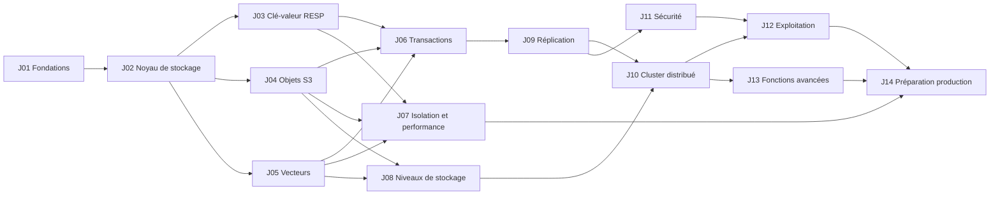

# Cahier des tâches — Ndaal

> **Document de suivi du projet.** Il recense toutes les tâches, regroupées en **jalons**, avec leurs dépendances, estimations, exigences couvertes et critères de fin. Cochez les cases au fur et à mesure et mettez à jour le tableau de bord.
>
> Rappel : un jalon est une **étape de construction**, pas une version publiée. Les numéros de version publiés sont décidés à la publication (voir [README.md](README.md#conventions-de-la-documentation)).

## Sommaire

- [Mode d'emploi](#mode-demploi)
- [Tableau de bord](#tableau-de-bord)
- [Enchaînement des jalons](#enchaînement-des-jalons)
- [J01 — Fondations du projet](#j01--fondations-du-projet)
- [J02 — Noyau de stockage](#j02--noyau-de-stockage)
- [J03 — Interface clé-valeur (RESP)](#j03--interface-clé-valeur-resp)
- [J04 — Stockage d'objets local (S3)](#j04--stockage-dobjets-local-s3)
- [J05 — Moteur vectoriel](#j05--moteur-vectoriel)
- [J06 — Transactions multi-modèles](#j06--transactions-multi-modèles)
- [J07 — Isolation des ressources et performance](#j07--isolation-des-ressources-et-performance)
- [J08 — Stockage par niveaux](#j08--stockage-par-niveaux)
- [J09 — Réplication et haute disponibilité](#j09--réplication-et-haute-disponibilité)
- [J10 — Cluster distribué](#j10--cluster-distribué)
- [J11 — Sécurité et multi-locataire](#j11--sécurité-et-multi-locataire)
- [J12 — Exploitation](#j12--exploitation)
- [J13 — Fonctions avancées et écosystème](#j13--fonctions-avancées-et-écosystème)
- [J14 — Préparation à la production](#j14--préparation-à-la-production)
- [Journal des jalons](#journal-des-jalons)
- [Registre des modifications du plan](#registre-des-modifications-du-plan)

---

## Mode d'emploi

### Format d'une tâche

```markdown
- [ ] **T05.07** — Titre de la tâche
  - Estimation : L · Dépend de : T05.03, T05.04 · Exigences : EF-VEC-05, ADR-011
  - Fin : critère vérifiable qui permet de cocher la tâche.
```

### États

| Notation | État |
|---|---|
| `- [ ]` | À faire |
| `- [ ]` suivi de `*(en cours — nom, date de début)*` à la fin du titre | En cours |
| `- [ ]` suivi de `*(bloquée — raison)*` | Bloquée |
| `- [x]` | Terminée (critère de fin vérifié, revue faite, CI verte) |
| `- [x] ~~Titre~~` suivi de `*(abandonnée — raison, voir registre)*` | Abandonnée |

### Échelle d'estimation

Effort d'**une personne expérimentée**, hors revue et attente :

| Code | Effort |
|---|---|
| XS | ≤ 0,5 jour |
| S | 1 à 2 jours |
| M | 3 à 5 jours |
| L | 1 à 2 semaines |
| XL | 3 à 4 semaines (à découper si possible) |

### Règles

1. Une tâche n'est cochée que si son **critère de fin** est vérifié, ses tests écrits et la CI verte.
2. Une tâche découverte en cours de route est **ajoutée** au jalon concerné avec le numéro suivant libre, et consignée dans le [registre des modifications](#registre-des-modifications-du-plan).
3. Une tâche n'est jamais renumérotée ni supprimée : elle est marquée abandonnée.
4. Un jalon est terminé selon les [critères de passage](STRATEGIE_DE_TESTS.md#14-critères-de-passage-dun-jalon) et ses propres critères de sortie ; on consigne alors une entrée dans le [journal des jalons](#journal-des-jalons).

---

## Tableau de bord

| Jalon | Intitulé | Tâches | Terminées | Avancement | Effort estimé (jours-personne) | État |
|---|---|---|---|---|---|---|
| J01 | Fondations du projet | 25 | 22 | 88 % | ~67 | En cours |
| J02 | Noyau de stockage | 26 | 0 | 0 % | ~106 | À faire |
| J03 | Interface clé-valeur (RESP) | 29 | 0 | 0 % | ~106 | À faire |
| J04 | Stockage d'objets local (S3) | 24 | 0 | 0 % | ~93 | À faire |
| J05 | Moteur vectoriel | 27 | 0 | 0 % | ~126 | À faire |
| J06 | Transactions multi-modèles | 16 | 0 | 0 % | ~70 | À faire |
| J07 | Isolation des ressources et performance | 17 | 0 | 0 % | ~96 | À faire |
| J08 | Stockage par niveaux | 17 | 0 | 0 % | ~74 | À faire |
| J09 | Réplication et haute disponibilité | 17 | 0 | 0 % | ~80 | À faire |
| J10 | Cluster distribué | 22 | 0 | 0 % | ~116 | À faire |
| J11 | Sécurité et multi-locataire | 15 | 0 | 0 % | ~63 | À faire |
| J12 | Exploitation | 27 | 0 | 0 % | ~113 | À faire |
| J13 | Fonctions avancées et écosystème | 22 | 0 | 0 % | ~134 | À faire |
| J14 | Préparation à la production | 15 | 0 | 0 % | ~76 | À faire |
| **Total** | | **299** | **22** | **7 %** | **~1319** | |

États possibles d'un jalon : **À faire**, **En cours**, **Terminé**. Mettez à jour les colonnes « Terminées », « Avancement » et « État » à chaque tâche cochée (ou générez-les avec le script ci-dessous).

L'effort est une somme indicative (XS = 0,5 ; S = 1,5 ; M = 4 ; L = 7,5 ; XL = 17,5 jours-personne), hors revue, tests de longue durée et imprévus : prévoir une marge de 30 à 50 %. Les jalons parallélisables (J03/J04/J05, J07/J08/J09) réduisent la durée calendaire si plusieurs personnes y travaillent.

<details>
<summary>Script de calcul de l'avancement</summary>

```bash
# Compte les tâches cochées et totales par jalon
for j in $(seq -w 1 14); do
  total=$(grep -c "^- \[.\] \*\*T$j\." CAHIER_DES_TACHES.md)
  fait=$(grep -c "^- \[x\] \*\*T$j\." CAHIER_DES_TACHES.md)
  echo "J$j : $fait / $total"
done
```

</details>

---

## Enchaînement des jalons



Lecture : J03, J04 et J05 peuvent avancer **en parallèle** après J02. J07 et J08 peuvent avancer en parallèle de J09.

Chaque jalon produit un **résultat utilisable** :

| Après | On dispose de… |
|---|---|
| J03 | Un remplaçant de Redis durable sur un nœud |
| J04 | + un stockage S3 sur un nœud |
| J05 | + une base vectorielle sur un nœud |
| J06 | Le produit différenciant : les trois modèles avec transactions atomiques, sur un nœud |
| J08 | + données plus grandes que la RAM et le disque local, stockage objet externe |
| J09 | + haute disponibilité sur 3 nœuds |
| J10 | + cluster élastique avec rôles et codes d'effacement |
| J14 | Prêt pour la production |

---

## J01 — Fondations du projet

**Objectif** : poser le dépôt, l'outillage, les abstractions d'E/S et le banc de simulation, pour que tout le code suivant soit testable de façon déterministe dès le premier jour.

**Livrable** : workspace Cargo, CI complète, `ndaal-io` (réel + simulé), squelette de `ndaal-sim`, observabilité de base, binaire `ndaal` vide.

**Critères de sortie** : CI GitHub Actions verte sur Linux, macOS et Windows, suite de tests complète comprise ; image de conteneur construite et démarrée en CI ; un test de simulation trivial (deux tâches échangeant des messages avec pannes réseau) est rejouable à l'identique depuis sa graine.

- [x] **T01.01** — Créer le workspace Cargo et l'arborescence des crates ([ARCHITECTURE.md §3](ARCHITECTURE.md#3-organisation-du-code))
  - Estimation : S · Dépend de : — · Exigences : EF-GEN-01
  - Fin : `cargo build --workspace` compile toutes les crates (vides) ; versions des dépendances centralisées dans `[workspace.dependencies]`.
- [x] **T01.02** — Configurer `cargo deny` (licences autorisées, sources, avis de sécurité, doublons)
  - Estimation : XS · Dépend de : T01.01 · Exigences : C-02, ENF-SEC-02
  - Fin : `cargo deny check` en CI, échoue sur une licence interdite (test avec une dépendance factice).
- [x] **T01.03** — Mettre en place la CI de base : `fmt`, `clippy -D warnings`, `nextest`, MSRV, matrice Linux x86_64/aarch64, macOS, Windows
  - Estimation : M · Dépend de : T01.01 · Exigences : ENF-QUAL-02, ENF-PORT-01/02/04
  - Fin : chaque demande de fusion déclenche la CI ; temps < 15 min grâce au cache de compilation.
- [x] **T01.04** — Écrire le lint maison interdisant l'accès direct à l'horloge, au disque, au réseau et à l'aléa hors `ndaal-io`
  - Estimation : S · Dépend de : T01.03 · Exigences : ADR-017
  - Fin : un appel à `std::time::Instant::now` dans `ndaal-kv` fait échouer la CI.
- [x] **T01.05** — `ndaal-common` : identifiants (§10 des formats), types d'erreurs, utilitaires d'octets, `varint`
  - Estimation : S · Dépend de : T01.01 · Exigences : —
  - Fin : tests de propriétés aller-retour sur tous les encodages.
- [x] **T01.06** — `ndaal-common` : configuration (TOML, variables d'environnement, ligne de commande) avec priorités, validation et génération de la référence
  - Estimation : M · Dépend de : T01.05 · Exigences : EF-GEN-04, EF-GEN-05
  - Fin : test de priorité des trois sources ; `ndaal config reference` produit la liste des paramètres avec types et défauts.
- [x] **T01.07** — `ndaal-io` : traits `Clock`, `Rng`, `Disk`/`File`, `Network` et implémentations réelles
  - Estimation : M · Dépend de : T01.05 · Exigences : ADR-016, ADR-017
  - Fin : tests d'intégration des implémentations réelles (fichiers, `fdatasync`, TCP).
- [x] **T01.08** — `ndaal-io` : implémentations simulées (horloge virtuelle, disque en mémoire perdant les écritures non synchronisées et pouvant les déchirer, réseau avec latence/pertes/partitions)
  - Estimation : L · Dépend de : T01.07 · Exigences : ADR-017, ENF-QUAL-05
  - Fin : tests montrant qu'une coupure simulée perd exactement les écritures non synchronisées.
- [x] **T01.09** — `ndaal-sim` : ordonnanceur déterministe mono-thread, exécution d'un scénario à partir d'une graine, injection de pannes, rejouabilité
  - Estimation : L · Dépend de : T01.08 · Exigences : ADR-017
  - Fin : deux exécutions avec la même graine produisent une trace identique (empreinte comparée) ; commande `ndaal-sim run --seed N`.
- [x] **T01.10** — `ndaal-observe` : journaux structurés (`tracing`), format JSON/texte, niveau modifiable à chaud
  - Estimation : S · Dépend de : T01.06 · Exigences : EF-OPS-03
  - Fin : changement de niveau sans redémarrage démontré par un test.
- [x] **T01.11** — `ndaal-observe` : métriques locales par cœur et exportateur Prometheus *(exposition HTTP `/metrics` reportée au frontal HTTP : P-27)*
  - Estimation : M · Dépend de : T01.10 · Exigences : EF-OPS-01
  - Fin : `/metrics` expose des compteurs et histogrammes agrégés depuis plusieurs threads, sans verrou sur le chemin d'incrémentation.
- [x] **T01.12** — `ndaal-cli` : binaire `ndaal` (clap) avec sous-commandes `server`, `admin`, `backup`, `restore`, `bench`, `config`, `doctor`
  - Estimation : S · Dépend de : T01.06 · Exigences : EF-GEN-07
  - Fin : `ndaal --help` liste les sous-commandes.
- [x] **T01.13** — Mesure de couverture et rapport en CI
  - Estimation : S · Dépend de : T01.03 · Exigences : ENF-QUAL-01
  - Fin : rapport publié sur chaque demande de fusion.
- [ ] **T01.14** — Infrastructure de fuzzing (`cargo fuzz`, corpus versionnés, exécution nocturne)
  - Estimation : S · Dépend de : T01.03 · Exigences : ENF-SEC-03
  - Fin : une cible d'exemple tourne chaque nuit, les plantages ouvrent un ticket.
- [x] **T01.15** — Infrastructure de bancs (`criterion`, dossier `bench/`, stockage et graphe des résultats nocturnes)
  - Estimation : S · Dépend de : T01.03 · Exigences : ENF-PERF
  - Fin : un micro-banc d'exemple est tracé dans le temps.
- [x] **T01.16** — Fichiers du projet : `LICENSE` (Apache 2.0), `SECURITY.md`, `CONTRIBUTING.md` (DCO), code de conduite, modèles de tickets et de demandes de fusion
  - Estimation : XS · Dépend de : T01.01 · Exigences : ADR-001, ENF-SEC-05, ENF-QUAL-04
  - Fin : fichiers présents ; vérification DCO active en CI ; `CONTRIBUTING.md` impose un test de non-régression pour toute correction.
- [x] **T01.17** — Publier cette documentation dans `docs/` avec un site généré (mdBook)
  - Estimation : S · Dépend de : T01.01 · Exigences : ENF-DOC-01
  - Fin : site construit en CI ; liens internes vérifiés automatiquement.
- [ ] **T01.18** — Banc d'essai comparatif `bench/compare/` : lancement tour à tour de Ndaal et d'une référence en conteneur (Valkey, Qdrant, MinIO/RustFS), confinement CPU identique, consignation des versions et configurations, comparaison automatique à la tolérance ENF-COMP, exécution nocturne
  - Estimation : M · Dépend de : T01.15 · Exigences : ENF-COMP, O7, ADR-027
  - Fin : un banc d'exemple compare Valkey à lui-même et produit un rapport ; un écart simulé au-delà de la tolérance ouvre un ticket.
- [x] **T01.19** — Hygiène du code en CI : `rustfmt.toml` (`max_width = 100`), `clippy.toml` (seuils de taille), `.gitattributes` (LF), script `scripts/check-hygiene.sh` (taille des fichiers, emojis, caractères non ASCII, espaces de fin, fins de ligne)
  - Estimation : S · Dépend de : T01.03 · Exigences : ENF-QUAL-02, CLAUDE.md §4.6 et §4.7
  - Fin : la CI rejette une demande de fusion d'essai contenant un emoji, un fichier `.rs` de plus de 800 lignes et une fonction de plus de 100 lignes ; les exceptions déclarées (code généré, `#[allow]` justifié) passent.
- [x] **T01.20** — Workflows GitHub Actions `ci.yml`, `nightly.yml`, `docs.yml` : permissions minimales, actions épinglées par empreinte, cache de compilation, `concurrency`, Dependabot (Cargo et actions), protection de `main` *(Dependabot a tourné avec succès pour Cargo et les actions le 2026-10-13 sans rien à proposer : aucune dépendance, actions déjà à jour)*
  - Estimation : M · Dépend de : T01.03 · Exigences : ENF-QUAL-06, ENF-QUAL-07, ADR-028
  - Fin : une demande de fusion déclenche `ci.yml` sur les quatre exécuteurs ; `main` refuse une fusion sans CI verte ni relecture ; Dependabot ouvre ses premières demandes.
- [x] **T01.21** — Suite de tests complète sous macOS et Windows en CI (implémentations d'E/S de repli, chemins, fins de ligne)
  - Estimation : S · Dépend de : T01.20, T01.07 · Exigences : ENF-PORT-02
  - Fin : `cargo nextest run` vert sur `macos-latest` et `windows-latest`, sans test ignoré propre à un système.
- [ ] **T01.22** — Dockerfile en plusieurs étapes et `deploy/docker/compose.yaml` (nœud unique) ; construction et démarrage vérifiés en CI
  - Estimation : S · Dépend de : T01.12 · Exigences : EF-OPS-07, EF-OPS-12
  - Fin : `docker compose up` démarre un nœud dont `/health/ready` répond, sous Linux, macOS et Windows.
- [x] **T01.23** — `ndaal-i18n` : chargement Fluent, choix de la langue (ENF-I18N-03), repli sur l'anglais, vérification de complétude en CI ; messages existants de la CLI en anglais et en français
  - Estimation : M · Dépend de : T01.12 · Exigences : ENF-I18N-01 à 05, ADR-029
  - Fin : `ndaal --lang fr --help` s'affiche en français ; une clé manquante en français retombe sur l'anglais ; la CI échoue si une clé manque.
- [x] **T01.24** — Conventions d'erreurs : profil `panic = "abort"`, gestionnaire de panique (journal, métrique, vidage), identifiant de requête propagé, guide des erreurs dans `ndaal-common`
  - Estimation : S · Dépend de : T01.05, T01.10 · Exigences : ADR-030, ENF-DUR-03
  - Fin : une panique provoquée en test d'intégration produit un journal avec pile d'appels et identifiant de requête, puis l'arrêt du processus.
- [x] **T01.25** — Versions figées des outils (`rust-toolchain.toml`, `scripts/tools.versions`, installation identique en local et en CI) et script `scripts/check-linux.sh` (clippy et tests compilés pour Linux dans le conteneur Rust figé, depuis macOS ou Windows)
  - Estimation : S · Dépend de : T01.03 · Exigences : CLAUDE.md §4.12 et §11, ENF-PORT-02
  - Fin : la CI et le poste de développement utilisent les mêmes versions ; sous Windows, `check-linux.sh` signale une erreur volontaire placée dans du code `#[cfg(target_os = "linux")]`.

---

## J02 — Noyau de stockage

**Objectif** : construire le cœur commun à tous les modèles : runtime thread-per-core, ordonnanceur d'E/S, journal unifié, segments, manifeste, points de contrôle et reprise. Un moteur clé-valeur minimal (chaînes) sert à valider le noyau.

**Livrable** : un nœud qui accepte des écritures clé-valeur via une API Rust interne, durable selon le mode choisi, et qui survit à n'importe quelle coupure de courant.

**Critères de sortie** : 0 perte d'écriture acquittée sur 10 000 graines de simulation avec coupures ; reprise vérifiée après coupure pendant un point de contrôle ; latence `fdatasync` groupée mesurée.

- [ ] **T02.01** — `ndaal-runtime` : un runtime `tokio` `current_thread` par cœur, épinglage, cycle de vie
  - Estimation : M · Dépend de : T01.07 · Exigences : ADR-003
  - Fin : N threads épinglés démarrent et s'arrêtent proprement ; fonctionne sans épinglage sur macOS/Windows.
- [ ] **T02.02** — Classes de charge (`shard`, `vector`, `transfer`, `background`, `io`) et attribution des cœurs (table par défaut + configuration)
  - Estimation : M · Dépend de : T02.01 · Exigences : ENF-ISO-01/02, ENF-RES-02
  - Fin : la table d'attribution de l'architecture (§4.1) est respectée de 2 à 64 cœurs (test unitaire).
- [ ] **T02.03** — Files SPSC bornées entre cœurs et messagerie requête/réponse
  - Estimation : M · Dépend de : T02.01 · Exigences : ENF-PERF-01
  - Fin : micro-banc aller-retour < 1 µs entre deux cœurs ; comportement correct quand la file est pleine.
- [ ] **T02.04** — Ordonnancement à deux files (priorité stricte + budget minimal) pour les cœurs partagés entre classes
  - Estimation : M · Dépend de : T02.02 · Exigences : ENF-ISO-02
  - Fin : test montrant que la classe secondaire reçoit ≥ 10 % du temps sous saturation de la classe principale.
- [ ] **T02.05** — Ordonnanceur d'E/S par périphérique : classes de priorité, pondération, seaux à jetons, profondeur bornée
  - Estimation : L · Dépend de : T02.02, T01.07 · Exigences : ENF-ISO-01
  - Fin : en simulation, une rafale d'écritures `basse` ne retarde pas une lecture `haute` au-delà d'une borne configurée.
- [ ] **T02.06** — Backend d'E/S « pool de threads » (`pread`, `pwrite`, `fdatasync`, `fallocate`)
  - Estimation : M · Dépend de : T02.05 · Exigences : ADR-016, ENF-PORT-03
  - Fin : suite de tests commune des backends réussie sur ext4 et XFS.
- [ ] **T02.07** — `ndaal-wal` : format d'enregistrement, encodage/décodage, CRC32C masqué ([FORMATS §2](FORMATS_DE_DONNEES.md#2-journal-wal))
  - Estimation : M · Dépend de : T01.05 · Exigences : ENF-DUR-03
  - Fin : tests de propriétés aller-retour ; tout octet modifié est détecté.
- [ ] **T02.08** — `ndaal-wal` : écrivain avec double tampon, écriture groupée, alignement 4 Kio, réécriture de la dernière page partielle
  - Estimation : L · Dépend de : T02.07, T02.06 · Exigences : ENF-PERF-03, ENF-DUR-01
  - Fin : le shard n'est jamais bloqué par un `fdatasync` ; débit ≥ 500 000 petits enregistrements/s par shard sur la machine de référence.
- [ ] **T02.09** — `ndaal-wal` : fichiers préalloués, recyclage, époque de recyclage
  - Estimation : M · Dépend de : T02.08 · Exigences : ENF-DUR-01
  - Fin : un fichier recyclé ne peut jamais faire relire un ancien enregistrement (test dédié).
- [ ] **T02.10** — `ndaal-wal` : lecteur ; distinction fin de journal / corruption ; enregistrements fragmentés
  - Estimation : M · Dépend de : T02.07 · Exigences : ENF-DUR-03
  - Fin : une troncature à n'importe quel octet donne un préfixe valide ; une corruption au milieu est signalée.
- [ ] **T02.11** — Modes de durabilité `none`, `async` (vidage périodique), `sync`
  - Estimation : S · Dépend de : T02.08 · Exigences : ENF-DUR-04
  - Fin : tests de chaque mode avec coupure simulée : seules les pertes autorisées par le mode se produisent.
- [ ] **T02.12** — `ndaal-storage` : abstraction `Partition` (LSN, application des effets, LSN appliqué/durable, attente de LSN)
  - Estimation : M · Dépend de : T02.08 · Exigences : EF-TX-09
  - Fin : API documentée ; tests d'application et d'attente.
- [ ] **T02.13** — Enveloppe de segment générique : en-tête, blocs avec CRC et compression LZ4, répertoire, pied ([FORMATS §3](FORMATS_DE_DONNEES.md#3-fichier-de-segment-générique))
  - Estimation : M · Dépend de : T02.06 · Exigences : ENF-DUR-03, ENF-QUAL-03, ADR-018
  - Fin : tout bloc corrompu est détecté à la lecture ; numéros de format vérifiés à l'ouverture.
- [ ] **T02.14** — Encodage des clés internes avec échappement et entiers gros-boutistes ([FORMATS §9](FORMATS_DE_DONNEES.md#9-encodage-des-clés-internes))
  - Estimation : S · Dépend de : T01.05 · Exigences : —
  - Fin : propriété « ordre des octets = ordre logique » vérifiée.
- [ ] **T02.15** — SST : écrivain et lecteur (blocs avec points de redémarrage, index, filtre de Bloom, propriétés)
  - Estimation : L · Dépend de : T02.13, T02.14 · Exigences : —
  - Fin : test de modèle contre `BTreeMap` ; taux de faux positifs du Bloom ≈ 1 %.
- [ ] **T02.16** — Manifeste protobuf (`prost`), fichier `CURRENT`, publication atomique (temporaire, `fsync`, renommage, `fsync` du répertoire)
  - Estimation : M · Dépend de : T02.13 · Exigences : ADR-015
  - Fin : coupure simulée à chaque étape : on lit toujours l'ancien ou le nouveau manifeste complet.
- [ ] **T02.17** — Points de contrôle flous : parcours par tranches sans bloquer le shard, `CHECKPOINT_BEGIN/END`
  - Estimation : L · Dépend de : T02.15, T02.16, T02.26 · Exigences : ADR-007
  - Fin : les écritures continuent pendant le point de contrôle ; latence p99 du shard non dégradée de plus de 20 %.
- [ ] **T02.18** — Reprise au démarrage : manifeste, segments, rejeu idempotent du journal depuis `checkpoint_lsn`
  - Estimation : M · Dépend de : T02.17, T02.10 · Exigences : ENF-DUR-01
  - Fin : état après reprise identique à l'état avant coupure (pour les écritures durables).
- [ ] **T02.19** — Troncature des fichiers de journal ; point de contrôle forcé de la partition qui retient le journal
  - Estimation : M · Dépend de : T02.18 · Exigences : ADR-004
  - Fin : l'espace du journal reste borné sous écriture continue.
- [ ] **T02.20** — Comptable mémoire global, budgets souples, enregistrement des grandes allocations
  - Estimation : M · Dépend de : T02.01 · Exigences : ENF-RES-04
  - Fin : la mémoire mesurée reste sous `memory.limit` dans un test de remplissage.
- [ ] **T02.21** — Répertoire de données : verrou exclusif, `NODE_ID`, arborescence, nettoyage de `tmp/`
  - Estimation : XS · Dépend de : T01.07 · Exigences : —
  - Fin : un second processus sur le même répertoire est refusé.
- [ ] **T02.22** — Arrêt propre sur `SIGTERM` : fin des requêtes, vidage du journal, fermeture
  - Estimation : S · Dépend de : T02.08 · Exigences : EF-GEN-08
  - Fin : aucune perte après arrêt propre, y compris en mode `async`.
- [ ] **T02.23** — Scénarios de simulation du noyau : coupures pendant écritures, points de contrôle, troncatures, publication de manifeste
  - Estimation : L · Dépend de : T02.18, T01.09 · Exigences : ENF-DUR-01, ENF-QUAL-05
  - Fin : 10 000 graines sans perte ; scénario intégré à la CI nocturne.
- [ ] **T02.24** — Cibles de fuzzing `fuzz_wal_reader`, `fuzz_segment_reader`, `fuzz_manifest`
  - Estimation : S · Dépend de : T02.10, T02.13, T02.16 · Exigences : ENF-SEC-03
  - Fin : cibles en CI nocturne.
- [ ] **T02.25** — Serveur HTTP minimal de santé et de métriques (`/health/live`, `/health/ready`, `/metrics`)
  - Estimation : S · Dépend de : T01.11 · Exigences : EF-OPS-04
  - Fin : `ready` ne passe à vrai qu'après la reprise de toutes les partitions.
- [ ] **T02.26** — Moteur clé-valeur minimal (chaînes : `get`, `set`, `del`, versions) branché sur la partition pour valider le noyau
  - Estimation : M · Dépend de : T02.12 · Exigences : ADR-007
  - Fin : tests de modèle et de reprise passent.

---

## J03 — Interface clé-valeur (RESP)

**Objectif** : un remplaçant de Redis durable sur un nœud, compatible avec les clients courants.

**Livrable** : port RESP fonctionnel, types chaîne/hash/liste/ensemble/ensemble trié, expiration, éviction, `MULTI/EXEC`.

**Critères de sortie** : suites de compatibilité des clients ENF-COMPAT-01 vertes sur le périmètre ; ENF-PERF-01 mesuré (objectif visé, écart documenté si non atteint, à résorber en J07) ; bancs comparatifs contre Valkey exécutés (T03.29), écarts documentés.

- [ ] **T03.01** — Décodeur/encodeur RESP2/RESP3 incrémental sans copie, avec limites strictes
  - Estimation : M · Dépend de : T01.05 · Exigences : EF-KV-01, EF-SEC-08
  - Fin : décodage identique en un tampon et en morceaux arbitraires (propriété) ; limites testées.
- [ ] **T03.02** — Serveur TCP : `SO_REUSEPORT` par cœur `shard`, gestion des connexions, pipelining, écriture groupée des réponses
  - Estimation : M · Dépend de : T03.01, T02.03 · Exigences : EF-KV-01, ENF-PERF-02
  - Fin : `redis-benchmark -P 16` fonctionne.
- [ ] **T03.03** — Table de commandes générée (arité, drapeaux, positions des clés) ; `COMMAND`, `COMMAND DOCS`, `COMMAND COUNT`
  - Estimation : M · Dépend de : T03.01 · Exigences : EF-KV-10, ENF-DOC-03
  - Fin : la liste des commandes supportées est générée pour la documentation.
- [ ] **T03.04** — Routage commande → partition → shard ; transfert inter-cœurs ; découpage des commandes multi-clés
  - Estimation : M · Dépend de : T03.03, T02.03 · Exigences : EF-KV-01
  - Fin : `MGET` sur des clés de plusieurs shards renvoie les valeurs dans l'ordre.
- [ ] **T03.05** — Valeurs typées et encodages compacts (chaîne, hash, liste, ensemble, ensemble trié) avec bascule automatique
  - Estimation : L · Dépend de : T02.26 · Exigences : EF-KV-05/06/07/08, ENF-RES-05
  - Fin : tests de modèle traversant les seuils de bascule.
- [ ] **T03.06** — Commandes sur les chaînes (liste EF-KV-02)
  - Estimation : M · Dépend de : T03.05 · Exigences : EF-KV-02
  - Fin : tests différentiels contre l'instance de référence.
- [ ] **T03.07** — Expiration : table des échéances, roue temporelle, expiration paresseuse et active, effet `EXPIRE_DEL`
  - Estimation : M · Dépend de : T03.05 · Exigences : EF-KV-03
  - Fin : aucune clé expirée n'est jamais lue ; budget d'expiration active respecté.
- [ ] **T03.08** — Gestion des clés et `SCAN` (curseur stable, `MATCH`, `COUNT`, `TYPE`)
  - Estimation : M · Dépend de : T03.05 · Exigences : EF-KV-04
  - Fin : `SCAN` complet renvoie toutes les clés présentes du début à la fin du parcours.
- [ ] **T03.09** — Commandes hash
  - Estimation : M · Dépend de : T03.05 · Exigences : EF-KV-05
  - Fin : tests différentiels.
- [ ] **T03.10** — Commandes listes, y compris bloquantes (`BLPOP`, `BRPOP`, `BLMOVE`)
  - Estimation : L · Dépend de : T03.05 · Exigences : EF-KV-06
  - Fin : réveil du premier client en attente ; délais respectés.
- [ ] **T03.11** — Commandes ensembles
  - Estimation : M · Dépend de : T03.05 · Exigences : EF-KV-07
  - Fin : tests différentiels.
- [ ] **T03.12** — Commandes ensembles triés (liste à enjambements + table membre → score)
  - Estimation : L · Dépend de : T03.05 · Exigences : EF-KV-08
  - Fin : tests différentiels, y compris `BYLEX` et `REV`.
- [ ] **T03.13** — `MULTI`, `EXEC`, `DISCARD`, `WATCH`, `UNWATCH`
  - Estimation : M · Dépend de : T03.04 · Exigences : EF-KV-09
  - Fin : tests de concurrence `WATCH` ; `CROSSSLOT` si plusieurs partitions.
- [ ] **T03.14** — Commandes de connexion et serveur (`HELLO`, `AUTH` provisoire, `SELECT`, `CLIENT`, `INFO`, `CONFIG`, `TIME`, `RESET`, `PING`, `ECHO`, `QUIT`)
  - Estimation : M · Dépend de : T03.02 · Exigences : EF-KV-10
  - Fin : tous les clients de ENF-COMPAT-01 s'initialisent sans erreur.
- [ ] **T03.15** — Erreurs explicites pour les commandes non supportées
  - Estimation : XS · Dépend de : T03.03 · Exigences : EF-KV-15
  - Fin : test de toutes les commandes Redis connues.
- [ ] **T03.16** — Effets journalisés idempotents pour chaque commande ([FORMATS §2.5](FORMATS_DE_DONNEES.md#25-effets))
  - Estimation : M · Dépend de : T03.06 à T03.12 · Exigences : ADR-007, ENF-DUR-01
  - Fin : test « rejouer deux fois = rejouer une fois » pour chaque commande d'écriture.
- [ ] **T03.17** — Politiques d'éviction par échantillonnage (`noeviction`, `*-lru`, `*-lfu`, `volatile-ttl`, `allkeys-random`)
  - Estimation : M · Dépend de : T03.05, T02.20 · Exigences : EF-KV-11
  - Fin : la mémoire reste sous le budget ; qualité LRU/LFU comparable à Redis sur une charge zipfienne.
- [ ] **T03.18** — Durabilité par espace de noms et par préfixe ; clés volatiles
  - Estimation : S · Dépend de : T02.11 · Exigences : EF-KV-12
  - Fin : test de redémarrage : les clés volatiles disparaissent, les durables restent.
- [ ] **T03.19** — Valeurs volumineuses (> 1 Mio) stockées hors ligne
  - Estimation : M · Dépend de : T02.15 · Exigences : EF-KV-16
  - Fin : valeur de 512 Mio écrite, relue, reprise après redémarrage.
- [ ] **T03.20** — `SLOWLOG`
  - Estimation : S · Dépend de : T03.02 · Exigences : EF-OPS-10
  - Fin : commandes au-delà du seuil enregistrées.
- [ ] **T03.21** — Catalogue local minimal : espace de noms `default`, création d'espaces, `NDAAL.NS`
  - Estimation : S · Dépend de : T02.12 · Exigences : EF-GEN-02, EF-GEN-03
  - Fin : deux espaces de noms isolés.
- [ ] **T03.22** — `NDAAL.DURABILITY`, `NDAAL.LSN`, `NDAAL.WAITLSN`, `NDAAL.INFO`
  - Estimation : S · Dépend de : T03.21 · Exigences : EF-TX-09
  - Fin : commandes documentées et testées.
- [ ] **T03.23** — Suite de compatibilité Redis avec les clients réels et tests différentiels contre une instance de référence
  - Estimation : L · Dépend de : T03.06 à T03.14 · Exigences : ENF-COMPAT-01
  - Fin : suite en CI ; taux de réussite publié.
- [ ] **T03.24** — Cibles de fuzzing `fuzz_resp_decoder` et `fuzz_resp_commands`
  - Estimation : S · Dépend de : T03.01 · Exigences : ENF-SEC-03, EF-SEC-08
  - Fin : cibles en CI nocturne.
- [ ] **T03.25** — Premiers bancs `kv-latency` et `kv-throughput`
  - Estimation : S · Dépend de : T03.06 · Exigences : ENF-PERF-01, ENF-PERF-02
  - Fin : résultats consignés dans le journal des jalons.
- [ ] **T03.26** — TLS sur le port RESP (`rustls`)
  - Estimation : S · Dépend de : T03.02 · Exigences : EF-SEC-01
  - Fin : `redis-cli --tls` fonctionne.
- [ ] **T03.27** — Écoute sur `127.0.0.1` par défaut ; refus d'écouter sur une interface publique sans authentification configurée
  - Estimation : XS · Dépend de : T03.02 · Exigences : ENF-SEC-04
  - Fin : test de démarrage.
- [ ] **T03.28** — Scénarios de simulation clé-valeur : commandes aléatoires + coupures, comparaison au modèle
  - Estimation : M · Dépend de : T03.16, T02.23 · Exigences : ENF-DUR-01
  - Fin : 10 000 graines sans divergence.
- [ ] **T03.29** — Bancs comparatifs clé-valeur contre Valkey : `cmp-kv-latency`, `cmp-kv-pipeline`, `cmp-kv-machine` ; banc `kv-pipeline`
  - Estimation : M · Dépend de : T03.25, T01.18 · Exigences : ENF-COMP-01, 02, 03, ENF-PERF-11
  - Fin : résultats consignés dans le journal des jalons ; chaque écart défavorable a un ticket et une piste d'optimisation pour J07.

---

## J04 — Stockage d'objets local (S3)

**Objectif** : un stockage S3 compatible sur un nœud, avec flux d'octets hors journal.

**Livrable** : port S3 avec compartiments, objets, listages, multipart, URL présignées, étiquettes, politiques, CORS.

**Critères de sortie** : `ceph/s3-tests` filtré ≥ 80 % (≥ 90 % visé en J14) ; clients ENF-COMPAT-02 fonctionnels ; aucun objet partiel visible après coupure ; bancs comparatifs contre MinIO/RustFS exécutés (T04.24), écarts documentés.

- [ ] **T04.01** — Intégration de `s3s` : service, routage, adressage par chemin et par hôte virtuel
  - Estimation : M · Dépend de : T02.01 · Exigences : EF-OBJ-10, ADR-013
  - Fin : `aws s3 ls` répond (liste vide).
- [ ] **T04.02** — Authentification SigV4 (en-tête, présignée, flux `STREAMING-AWS4-HMAC-SHA256-PAYLOAD`, `UNSIGNED-PAYLOAD`) avec stockage provisoire des clés
  - Estimation : M · Dépend de : T04.01 · Exigences : EF-OBJ-06, EF-OBJ-07
  - Fin : aws-cli, boto3 et aws-sdk-js s'authentifient ; URL présignée GET et PUT fonctionnelles.
- [ ] **T04.03** — Compartiments : création, suppression (vide), liste, `HeadBucket`, `GetBucketLocation`, unicité, rattachement à un espace de noms
  - Estimation : M · Dépend de : T04.01, T03.21 · Exigences : EF-OBJ-01
  - Fin : tests de compatibilité des opérations de compartiment.
- [ ] **T04.04** — `LocalBlobStore` : fichiers d'extension préalloués, allocation, en-têtes de blocs, CRC, table d'allocation journalisée
  - Estimation : L · Dépend de : T02.06, T02.15 · Exigences : ADR-010
  - Fin : tests de modèle ; coupure simulée sans fuite ni corruption de la table.
- [ ] **T04.05** — `PutObject` en flux sur les cœurs `transfer` : découpage en blocs, MD5/CRC32C/SHA-256 à la volée, validation `Content-MD5`
  - Estimation : M · Dépend de : T04.04 · Exigences : EF-OBJ-02, EF-OBJ-09
  - Fin : objet de 10 Gio envoyé avec mémoire bornée.
- [ ] **T04.06** — Objets en ligne (≤ 64 Kio) dans le journal
  - Estimation : S · Dépend de : T04.07 · Exigences : ENF-PERF-08
  - Fin : un seul `fdatasync` par petit objet.
- [ ] **T04.07** — Index des métadonnées objet (mémoire ordonnée + SST) et effets objet journalisés
  - Estimation : L · Dépend de : T02.15, T02.14 · Exigences : EF-OBJ-02
  - Fin : test de modèle ; reprise après coupure.
- [ ] **T04.08** — `GetObject` et `HeadObject` : plages, requêtes conditionnelles, lecture anticipée
  - Estimation : M · Dépend de : T04.07, T04.04 · Exigences : EF-OBJ-05
  - Fin : tests de compatibilité des plages et conditions.
- [ ] **T04.09** — `DeleteObject` et `DeleteObjects`
  - Estimation : S · Dépend de : T04.07 · Exigences : EF-OBJ-02
  - Fin : tests de compatibilité.
- [ ] **T04.10** — `ListObjectsV2` et `ListObjects` : préfixe, délimiteur, préfixes communs par saut, pagination
  - Estimation : M · Dépend de : T04.07 · Exigences : EF-OBJ-03, ENF-SCAL-05
  - Fin : listage d'un préfixe dans un compartiment de 100 M objets en temps proportionnel au résultat.
- [ ] **T04.11** — `CopyObject` par référence aux blocs
  - Estimation : S · Dépend de : T04.07 · Exigences : EF-OBJ-02
  - Fin : copie d'un objet de 10 Gio instantanée.
- [ ] **T04.12** — Multipart complet (7 opérations), ETag multipart, expiration des téléversements abandonnés
  - Estimation : L · Dépend de : T04.05, T04.07 · Exigences : EF-OBJ-04
  - Fin : objet de 100 Gio en 1 000 parties ; ETag identique à AWS.
- [ ] **T04.13** — Métadonnées utilisateur, en-têtes standard, étiquettes
  - Estimation : M · Dépend de : T04.07 · Exigences : EF-OBJ-08
  - Fin : tests de compatibilité.
- [ ] **T04.14** — En-têtes `x-amz-checksum-*` (CRC32, CRC32C, SHA1, SHA256), y compris en multipart et `GetObjectAttributes`
  - Estimation : M · Dépend de : T04.05, T04.12 · Exigences : EF-OBJ-09
  - Fin : vérification par les SDK récents.
- [ ] **T04.15** — Ramasse-miettes des blocs par marquage-balayage avec marge de sécurité
  - Estimation : L · Dépend de : T04.04, T04.07 · Exigences : ADR-022
  - Fin : en simulation, aucun bloc référencé n'est jamais supprimé ; les orphelins sont récupérés après la marge.
- [ ] **T04.16** — Récupération d'espace des fichiers d'extension (recopie des blocs vivants)
  - Estimation : M · Dépend de : T04.15 · Exigences : —
  - Fin : l'espace disque redescend après suppressions massives.
- [ ] **T04.17** — Politiques de compartiment (sous-ensemble) et ACL prédéfinies
  - Estimation : M · Dépend de : T04.03 · Exigences : EF-OBJ-13
  - Fin : tests d'autorisation (`public-read`, refus par préfixe, condition d'IP).
- [ ] **T04.18** — CORS par compartiment
  - Estimation : S · Dépend de : T04.03 · Exigences : EF-OBJ-14
  - Fin : requête préliminaire d'un navigateur acceptée/refusée selon la règle.
- [ ] **T04.19** — Suite de compatibilité S3 (`ceph/s3-tests` filtrée, clients ENF-COMPAT-02, `rclone`, `warp`)
  - Estimation : L · Dépend de : T04.02 à T04.14 · Exigences : ENF-COMPAT-02, ENF-COMPAT-03
  - Fin : suite en CI ; taux publié.
- [ ] **T04.20** — Cibles de fuzzing `fuzz_s3_requests` et `fuzz_sigv4`
  - Estimation : S · Dépend de : T04.02 · Exigences : ENF-SEC-03, EF-SEC-08
  - Fin : cibles en CI nocturne.
- [ ] **T04.21** — Bancs `obj-large` et `obj-small`
  - Estimation : S · Dépend de : T04.08 · Exigences : ENF-PERF-07, ENF-PERF-08
  - Fin : résultats consignés.
- [ ] **T04.22** — Simulation : coupures pendant envois simples et multipart ; aucun objet partiel visible
  - Estimation : M · Dépend de : T04.12, T02.23 · Exigences : ENF-DUR-01
  - Fin : 10 000 graines sans objet incohérent.
- [ ] **T04.23** — TLS sur le port S3
  - Estimation : XS · Dépend de : T04.01 · Exigences : EF-SEC-01
  - Fin : `aws --endpoint-url https://…` fonctionne.
- [ ] **T04.24** — Bancs comparatifs objet contre MinIO/RustFS sur un nœud : `cmp-obj-large`, `cmp-obj-small`
  - Estimation : S · Dépend de : T04.21, T01.18 · Exigences : ENF-COMP-06, 07
  - Fin : résultats consignés ; chaque écart défavorable a un ticket et une piste d'optimisation pour J07.

---

## J05 — Moteur vectoriel

**Objectif** : une base vectorielle complète sur un nœud : collections, points, HNSW, filtres, quantification.

**Livrable** : API HTTP/gRPC vectorielle, index HNSW propre, planificateur de recherche filtrée, quantification.

**Critères de sortie** : ENF-PERF-04 mesuré (rappel ≥ 0,95) ; rappel ≥ 0,95 avec filtre de sélectivité 0,5 % (EF-VEC-08) ; reprise après coupure sans perte ; bancs comparatifs contre Qdrant exécutés (T05.26), écarts documentés.

- [ ] **T05.01** — Frontal HTTP (`axum`) et gRPC (`tonic`) : squelette, format d'erreurs, pagination, jeton provisoire
  - Estimation : M · Dépend de : T02.01 · Exigences : EF-GEN-06
  - Fin : point de terminaison d'exemple en HTTP et gRPC avec erreurs normalisées.
- [ ] **T05.02** — Catalogue des collections (vecteurs nommés, validations) et API de gestion des collections
  - Estimation : M · Dépend de : T05.01, T03.21 · Exigences : EF-VEC-01, EF-VEC-02
  - Fin : création/description/modification/suppression testées.
- [ ] **T05.03** — Noyaux de distance SIMD (AVX2, AVX-512, NEON, scalaire) avec détection à l'exécution, pour `f32`, `f16`, `u8`
  - Estimation : M · Dépend de : T01.05 · Exigences : ENF-PERF-04
  - Fin : résultats identiques (à l'epsilon près) entre noyaux ; micro-bancs publiés.
- [ ] **T05.04** — Segment mutable : tableaux en ajout seul par blocs, compteur publié atomique, bitmap de suppressions
  - Estimation : L · Dépend de : T02.12 · Exigences : EF-VEC-15
  - Fin : lecture concurrente sûre depuis les cœurs `vector` (tests de concurrence, `loom` sur la partie atomique).
- [ ] **T05.05** — Stockage de la charge utile (JSON binaire), mises à jour partielles
  - Estimation : M · Dépend de : T05.04 · Exigences : EF-VEC-03, EF-VEC-04
  - Fin : tests de modèle.
- [ ] **T05.06** — Opérations sur les points (`upsert`, `get`, `delete` par identifiants et filtre, `set_payload`, `delete_payload`, `update_vectors`, `count`, `scroll`) et leurs effets journalisés
  - Estimation : L · Dépend de : T05.04, T05.05, T05.12 · Exigences : EF-VEC-04
  - Fin : API complète testée ; rejeu idempotent.
- [ ] **T05.07** — HNSW : insertion (heuristique de sélection des voisins), recherche, paramètres `m`, `ef_construct`, `ef`
  - Estimation : L · Dépend de : T05.03 · Exigences : EF-VEC-05, ADR-011
  - Fin : rappel@10 ≥ 0,95 sur SIFT-1M avec `ef` raisonnable ; comparaison avec `hnsw_rs` en test.
- [ ] **T05.08** — Construction HNSW parallèle sur les cœurs `vector`
  - Estimation : M · Dépend de : T05.07 · Exigences : ENF-PERF-06
  - Fin : accélération ≥ 5× sur 8 cœurs, rappel inchangé.
- [ ] **T05.09** — Gel du segment mutable en segment immuable ; indexation en arrière-plan ; publication atomique
  - Estimation : M · Dépend de : T05.04, T05.07, T05.10 · Exigences : EF-VEC-15
  - Fin : aucune recherche ne perd de points pendant le gel (test de concurrence).
- [ ] **T05.10** — Format de segment vectoriel (sections) : écriture, lecture, projection en mémoire (`mmap`) ([FORMATS §5](FORMATS_DE_DONNEES.md#5-segment-vectoriel))
  - Estimation : L · Dépend de : T02.13 · Exigences : —
  - Fin : aller-retour complet ; fuzzing du lecteur.
- [ ] **T05.11** — Index de charge utile : mot-clé, entier, flottant, booléen, date, géo, texte
  - Estimation : L · Dépend de : T05.05 · Exigences : EF-VEC-07
  - Fin : résultats des index identiques à l'évaluation directe (propriété).
- [ ] **T05.12** — Évaluateur de filtres et grammaire complète (`must`, `should`, `must_not`, `min_should`, plages, géo, texte, champs imbriqués)
  - Estimation : M · Dépend de : T05.05 · Exigences : EF-VEC-06
  - Fin : tests de la grammaire ; erreurs claires sur filtre invalide.
- [ ] **T05.13** — Planificateur de recherche filtrée (estimation de cardinalité, trois stratégies)
  - Estimation : L · Dépend de : T05.11, T05.07 · Exigences : EF-VEC-08
  - Fin : rappel ≥ 0,95 pour des sélectivités de 0,1 % à 100 %.
- [ ] **T05.14** — Liens supplémentaires par valeur pour les champs de type locataire (`is_tenant`)
  - Estimation : M · Dépend de : T05.13 · Exigences : EF-VEC-08
  - Fin : rappel maintenu pour un locataire représentant 0,01 % des points.
- [ ] **T05.15** — Quantification int8, binaire et PQ, avec re-classement et sur-échantillonnage
  - Estimation : L · Dépend de : T05.07 · Exigences : EF-VEC-09
  - Fin : empreinte mémoire et rappel publiés pour chaque mode.
- [ ] **T05.16** — Recherche : fusion multi-segments, seuil de score, `offset`, sélection des champs, `explain`
  - Estimation : M · Dépend de : T05.09, T05.13 · Exigences : EF-VEC-05
  - Fin : résultats identiques à une recherche exhaustive avec `exact=true`.
- [ ] **T05.17** — Recherche par lots
  - Estimation : S · Dépend de : T05.16 · Exigences : EF-VEC-10
  - Fin : API testée.
- [ ] **T05.18** — Cohérence de lecture : borne de 1 s par défaut, `strong` par attente de LSN
  - Estimation : S · Dépend de : T05.16, T02.12 · Exigences : EF-VEC-15
  - Fin : test de lecture immédiate après écriture en mode `strong`.
- [ ] **T05.19** — Compactage vectoriel (taux de supprimés, fusion de petits segments, compteurs de références)
  - Estimation : M · Dépend de : T05.09 · Exigences : —
  - Fin : la mémoire et le nombre de segments restent bornés sous mises à jour continues.
- [ ] **T05.20** — Instantanés de collection : export, import
  - Estimation : M · Dépend de : T05.10 · Exigences : EF-VEC-16
  - Fin : aller-retour avec résultats de recherche identiques.
- [ ] **T05.21** — Points de contrôle et reprise des segments vectoriels (bitmaps de suppressions compagnons)
  - Estimation : M · Dépend de : T05.09, T02.17 · Exigences : ENF-DUR-01
  - Fin : coupure simulée pendant le gel et le compactage sans perte.
- [ ] **T05.22** — Commandes RESP `NDAAL.VSEARCH` et `NDAAL.VUPSERT`
  - Estimation : S · Dépend de : T05.16, T03.03 · Exigences : —
  - Fin : utilisables depuis `redis-cli`.
- [ ] **T05.23** — Bancs de rappel (SIFT-1M, GloVe-100, 768 d) et bancs `vec-hnsw`, `vec-ingest`
  - Estimation : M · Dépend de : T05.16 · Exigences : ENF-PERF-04, ENF-PERF-06
  - Fin : résultats consignés.
- [ ] **T05.24** — Cibles de fuzzing `fuzz_http_json` et `fuzz_filter`
  - Estimation : S · Dépend de : T05.12 · Exigences : ENF-SEC-03
  - Fin : cibles en CI nocturne.
- [ ] **T05.25** — Simulation : ingestion, gel, compactage et recherches concurrentes avec coupures
  - Estimation : M · Dépend de : T05.21, T02.23 · Exigences : ENF-DUR-01
  - Fin : 10 000 graines sans perte ni résultat invalide.
- [ ] **T05.26** — Bancs comparatifs vectoriels contre Qdrant à rappel égal : `cmp-vec-search` (avec et sans filtres, sans et avec quantification int8), `cmp-vec-ingest`
  - Estimation : M · Dépend de : T05.23, T01.18 · Exigences : ENF-COMP-04, 05
  - Fin : courbes débit/rappel des deux systèmes publiées ; chaque écart défavorable a un ticket et une piste d'optimisation pour J07.

---

## J06 — Transactions multi-modèles

**Objectif** : livrer le cœur différenciant : transactions atomiques clé-valeur + vecteurs + objets, liens, cascades, invalidations.

**Livrable** : API `/tx`, objets provisoires, `NDAAL.TX`, SDK Rust, application RAG de référence sur un nœud.

**Critères de sortie** : en simulation avec pannes, aucune transaction partiellement visible et historiques sérialisables ; UC-01, UC-02, UC-03 fonctionnent de bout en bout ; ENF-PERF-10 mesuré ; `cmp-rag-mixed` exécuté (T06.16).

- [ ] **T06.01** — `ndaal-tx` : modèle d'opérations et de préconditions, validation
  - Estimation : M · Dépend de : T03.16, T04.07, T05.06 · Exigences : EF-TX-03
  - Fin : toutes les opérations et préconditions d'[API §6](API_ET_PROTOCOLES.md#6-api-transactionnelle) sont représentées et validées.
- [ ] **T06.02** — Exécution sur le shard : préconditions, expansion des règles, calcul des effets, enregistrement `TX` unique, application
  - Estimation : L · Dépend de : T06.01 · Exigences : EF-TX-01, EF-TX-02
  - Fin : coupure simulée à chaque étape : tout ou rien après reprise.
- [ ] **T06.03** — Objets provisoires : `STAGE`, échéance, `COMMIT_STAGED` sans recopie, nettoyage
  - Estimation : M · Dépend de : T04.12, T06.02 · Exigences : EF-TX-04
  - Fin : un objet provisoire non validé disparaît après l'échéance et ses blocs sont récupérés.
- [ ] **T06.04** — API HTTP et gRPC des objets provisoires (envoi simple, multipart, compartiment virtuel `.staging-<ns>`)
  - Estimation : M · Dépend de : T06.03, T05.01 · Exigences : EF-TX-04
  - Fin : envoi d'un fichier de 10 Gio en provisoire puis validation.
- [ ] **T06.05** — API HTTP `/tx` et service gRPC `Transactions` (résultats par opération, LSN, opérations dérivées)
  - Estimation : M · Dépend de : T06.02 · Exigences : EF-TX-08
  - Fin : exemples de la documentation exécutés en test.
- [ ] **T06.06** — Déduplication des réessais par clé d'idempotence
  - Estimation : M · Dépend de : T06.02 · Exigences : EF-TX-01
  - Fin : un réessai après délai d'attente ne réapplique pas la transaction (simulation).
- [ ] **T06.07** — Liens vers les objets et index inverse
  - Estimation : M · Dépend de : T06.02 · Exigences : EF-TX-05
  - Fin : l'index inverse reste cohérent sous mises à jour et suppressions (test de modèle).
- [ ] **T06.08** — Suppression en cascade (découpage des grosses cascades, état « suppression en cours »)
  - Estimation : L · Dépend de : T06.07 · Exigences : EF-TX-05
  - Fin : UC-03 : aucun point ni clé lié ne subsiste ; l'objet est invisible dès la première étape.
- [ ] **T06.09** — Règles d'invalidation déclaratives et index de préfixes
  - Estimation : M · Dépend de : T06.02 · Exigences : EF-TX-06
  - Fin : coût d'invalidation proportionnel au nombre de clés supprimées.
- [ ] **T06.10** — Limites de transaction (opérations, octets) et erreurs `TX_TOO_LARGE`
  - Estimation : S · Dépend de : T06.02 · Exigences : EF-TX-07
  - Fin : tests aux bornes.
- [ ] **T06.11** — `MULTI/EXEC/WATCH` réimplémentés sur le mécanisme commun ; commande `NDAAL.TX`
  - Estimation : S · Dépend de : T06.02, T03.13 · Exigences : EF-KV-09
  - Fin : suites de compatibilité toujours vertes.
- [ ] **T06.12** — SDK Rust (`ndaal-client`) : clé-valeur, vecteurs, objets, objets provisoires, transactions, aide « lire-modifier-écrire » avec réessais
  - Estimation : L · Dépend de : T06.05 · Exigences : EF-OUT-01, ADR-026
  - Fin : exemples compilés et testés contre un serveur réel.
- [ ] **T06.13** — Simulation : charges transactionnelles mixtes avec pannes ; vérification d'atomicité et de sérialisabilité
  - Estimation : L · Dépend de : T06.02, T02.23 · Exigences : EF-TX-01, EF-TX-02
  - Fin : 10 000 graines sans anomalie.
- [ ] **T06.14** — Banc `tx-overhead`
  - Estimation : S · Dépend de : T06.05 · Exigences : ENF-PERF-10
  - Fin : résultat consigné.
- [ ] **T06.15** — Application RAG de référence, nœud unique (`tests/e2e/rag/`)
  - Estimation : M · Dépend de : T06.12 · Exigences : O1, UC-01/02/03
  - Fin : scénario de bout en bout en CI.
- [ ] **T06.16** — Banc `cmp-rag-mixed` : application RAG de référence sur Ndaal seul contre Valkey + Qdrant + MinIO, ressources identiques
  - Estimation : M · Dépend de : T06.15, T01.18 · Exigences : ENF-COMP-08
  - Fin : résultats consignés ; si Ndaal n'est pas meilleur, analyse de la cause et ticket pour J07.

---

## J07 — Isolation des ressources et performance

**Objectif** : atteindre les objectifs de latence, de débit et d'isolation sur un nœud.

**Livrable** : backend `io_uring`, contrôle d'admission, quotas de débit, optimisations, bancs d'isolation en CI.

**Critères de sortie** : ENF-PERF-01/02/11, ENF-ISO-01/02/03/05 atteints sur la machine de référence (ou écart documenté avec plan) ; ENF-RES-02 vérifié ; **parité ENF-COMP-01 à 08 atteinte sur un nœud, sans dérogation** (le jalon ne peut pas être clos sinon).

- [ ] **T07.01** — Backend d'E/S `io_uring` (`O_DIRECT`, tampons enregistrés, regroupement des soumissions)
  - Estimation : L · Dépend de : T02.06 · Exigences : ADR-016, ENF-PERF-03
  - Fin : suite commune des backends réussie ; gain mesuré.
- [ ] **T07.02** — Réglage automatique de la bande passante de fond selon la latence des E/S prioritaires
  - Estimation : M · Dépend de : T02.05 · Exigences : ENF-ISO-01
  - Fin : banc `iso-compaction` dans l'objectif.
- [ ] **T07.03** — Files d'admission bornées par classe et réponses de surcharge par protocole
  - Estimation : M · Dépend de : T03.02, T04.01, T05.01 · Exigences : ENF-ISO-05
  - Fin : banc `iso-overload` : mémoire bornée, erreurs réessayables, reprise après la charge.
- [ ] **T07.04** — Seaux à jetons par espace de noms avant admission
  - Estimation : M · Dépend de : T07.03 · Exigences : ENF-ISO-04, EF-SEC-04
  - Fin : banc `iso-tenant` dans l'objectif.
- [ ] **T07.05** — Migration à chaud d'une partition entre cœurs `shard`
  - Estimation : M · Dépend de : T02.19 · Exigences : ENF-PERF-02
  - Fin : interruption < 10 ms ; aucune requête perdue.
- [ ] **T07.06** — Allocateur `mimalloc` et allocations alignées comptabilisées
  - Estimation : S · Dépend de : T02.20 · Exigences : ADR-019, ENF-RES-04
  - Fin : fragmentation mesurée sur charge de 24 h.
- [ ] **T07.07** — Profilage et optimisation du chemin `GET`/`SET` (zéro copie, écritures réseau vectorisées, réduction des messages inter-cœurs)
  - Estimation : L · Dépend de : T03.25 · Exigences : ENF-PERF-01, ENF-PERF-02
  - Fin : objectifs atteints ou écart documenté.
- [ ] **T07.08** — Réduction du surcoût mémoire par clé
  - Estimation : M · Dépend de : T03.05 · Exigences : ENF-RES-05
  - Fin : banc `memory-overhead` < 64 octets par clé.
- [ ] **T07.09** — Bancs d'isolation `iso-*` automatisés en CI nocturne
  - Estimation : M · Dépend de : T07.03 · Exigences : ENF-ISO-01 à 05
  - Fin : résultats tracés ; alerte en cas de régression.
- [ ] **T07.10** — Mode petite machine (2 cœurs, 2 Gio) : partage des classes, budgets réduits
  - Estimation : M · Dépend de : T02.04 · Exigences : ENF-RES-01, ENF-RES-02
  - Fin : charge légère sans erreur ; mémoire au repos < 100 Mio.
- [ ] **T07.11** — Démarrage à froid rapide (chargement parallèle des partitions, ouverture paresseuse des segments)
  - Estimation : M · Dépend de : T02.18 · Exigences : ENF-PERF-09
  - Fin : banc `restart` < 60 s.
- [ ] **T07.12** — Commande `ndaal doctor` (réglages système, version du noyau, `io_uring`, THP, limites)
  - Estimation : S · Dépend de : T01.12 · Exigences : —
  - Fin : rapport lisible avec recommandations.
- [ ] **T07.13** — Rapport de performance du jalon (méthode, résultats, écarts)
  - Estimation : S · Dépend de : T07.07, T07.09 · Exigences : ENF-PERF
  - Fin : consigné dans le journal des jalons.
- [ ] **T07.14** — Résorption des écarts de parité clé-valeur : profilage comparé à Valkey (`perf`, graphes de flammes), optimisations jusqu'à parité
  - Estimation : XL · Dépend de : T03.29, T07.07 · Exigences : ENF-COMP-01, 02, 03
  - Fin : `cmp-kv-*` à parité ou mieux sur 3 nuits consécutives.
- [ ] **T07.15** — Résorption des écarts de parité vectorielle : profilage comparé à Qdrant (noyaux SIMD, disposition mémoire du graphe, préchargement, planificateur filtré)
  - Estimation : XL · Dépend de : T05.26 · Exigences : ENF-COMP-04, 05
  - Fin : `cmp-vec-*` à parité ou mieux sur 3 nuits consécutives.
- [ ] **T07.16** — Résorption des écarts de parité objet : chemin `PUT`/`GET` zéro copie, regroupement des `fsync`, listages
  - Estimation : L · Dépend de : T04.24, T07.01 · Exigences : ENF-COMP-06, 07
  - Fin : `cmp-obj-*` à parité ou mieux sur 3 nuits consécutives.
- [ ] **T07.17** — Rapport de parité du jalon : tous les bancs `cmp-*` complets, graphiques, versions, scripts de reproduction
  - Estimation : S · Dépend de : T07.14, T07.15, T07.16, T06.16 · Exigences : ENF-COMP, O7
  - Fin : rapport consigné dans le journal des jalons ; `cmp-rag-mixed` montre Ndaal meilleur que les trois services réunis.

---

## J08 — Stockage par niveaux

**Objectif** : gérer la hiérarchie RAM → NVMe → stockage objet ; permettre le mode désagrégé.

**Livrable** : cache hybride, température, débordement clé-valeur, segments distants, stockage objet externe, règles de placement.

**Critères de sortie** : un nœud détruit est reconstruit depuis le stockage objet (EF-NIV-02) ; jeu de données 10× plus grand que la RAM servi correctement ; ENF-ISO tenus pendant les transferts entre niveaux.

- [ ] **T08.01** — Intégration du cache hybride `foyer` (RAM + NVMe), admission TinyLFU, lectures « ne pas mettre en cache »
  - Estimation : M · Dépend de : T02.13 · Exigences : ADR-021, EF-NIV-01
  - Fin : un parcours complet ne chasse pas le jeu de travail (test).
- [ ] **T08.02** — Suivi de température (compteurs logarithmiques avec décroissance, esquisse Count-Min)
  - Estimation : M · Dépend de : T03.05 · Exigences : EF-NIV-03
  - Fin : promotion après accès répétés démontrée.
- [ ] **T08.03** — Politique d'éviction `tiered` : débordement vers SST, lecture via filtres de Bloom, promotion
  - Estimation : L · Dépend de : T08.02, T02.15 · Exigences : EF-KV-11, ENF-SCAL-03
  - Fin : 1 milliard de clés sur un nœud avec RAM limitée (banc).
- [ ] **T08.04** — Éviction et chargement à la demande des sections de segments vectoriels
  - Estimation : M · Dépend de : T08.01, T05.10 · Exigences : EF-NIV-03
  - Fin : collection 5× plus grande que le budget `vector` interrogeable.
- [ ] **T08.05** — Backends de stockage objet (S3, GCS, Azure, système de fichiers) via la crate `object_store`
  - Estimation : M · Dépend de : T01.07 · Exigences : EF-NIV-05
  - Fin : tests d'intégration par fournisseur (émulateurs en CI).
- [ ] **T08.06** — `ExternalBlobStore` avec regroupement des petits blocs en paquets
  - Estimation : L · Dépend de : T08.05, T04.04 · Exigences : EF-NIV-01
  - Fin : nombre de requêtes externes réduit d'au moins 10× pour des objets de 64 Kio.
- [ ] **T08.07** — Envoi des segments et manifestes vers le stockage objet (mode désagrégé)
  - Estimation : L · Dépend de : T08.05, T02.16 · Exigences : EF-NIV-02, ADR-009
  - Fin : le manifeste distant n'est publié qu'après l'envoi complet des segments qu'il référence.
- [ ] **T08.08** — Archivage du journal dans le stockage objet
  - Estimation : M · Dépend de : T08.07, T02.19 · Exigences : EF-OPS-06
  - Fin : rejeu possible depuis les archives.
- [ ] **T08.09** — Ouverture paresseuse des segments distants et lecture par plages
  - Estimation : M · Dépend de : T08.07 · Exigences : EF-NIV-02
  - Fin : démarrage d'un nœud sans télécharger les segments.
- [ ] **T08.10** — Reconstruction d'un nœud unique depuis le stockage objet
  - Estimation : M · Dépend de : T08.08, T08.09 · Exigences : EF-NIV-02
  - Fin : destruction du disque local puis reprise depuis le stockage objet sans perte des données archivées.
- [ ] **T08.11** — Bascule en ligne du mode `local` vers `disaggregated`
  - Estimation : M · Dépend de : T08.07 · Exigences : ADR-009
  - Fin : bascule sous charge sans interruption.
- [ ] **T08.12** — Règles de placement (épinglage par espace, collection, préfixe, compartiment)
  - Estimation : M · Dépend de : T08.03, T08.04 · Exigences : EF-NIV-04
  - Fin : un préfixe épinglé en RAM n'est jamais débordé.
- [ ] **T08.13** — Transition des blocs d'objets froids et classes de stockage `HOT`/`COLD`
  - Estimation : M · Dépend de : T08.06 · Exigences : EF-NIV-03
  - Fin : blocs transférés après `cold_after` ; lecture transparente.
- [ ] **T08.14** — Limite stricte de la taille du cache NVMe
  - Estimation : S · Dépend de : T08.01 · Exigences : EF-NIV-06
  - Fin : jamais dépassée (test de remplissage).
- [ ] **T08.15** — Comportement en cas d'indisponibilité du stockage objet (réserve locale, envoi différé, erreurs réessayables)
  - Estimation : M · Dépend de : T08.07 · Exigences : §18 de l'architecture
  - Fin : scénario d'indisponibilité d'une heure sans perte.
- [ ] **T08.16** — Simulation : pannes, latences et réponses partielles du stockage objet
  - Estimation : M · Dépend de : T08.07, T02.23 · Exigences : ENF-DUR-01
  - Fin : 10 000 graines sans perte.
- [ ] **T08.17** — Banc des niveaux (latence des données froides, efficacité du cache)
  - Estimation : S · Dépend de : T08.09 · Exigences : —
  - Fin : résultats consignés.

---

## J09 — Réplication et haute disponibilité

**Objectif** : répliquer chaque partition avec Raft, basculer automatiquement, et mettre en place le plan de contrôle.

**Livrable** : cluster de 3 nœuds tolérant la perte d'un nœud, protocole interne, groupe Raft système.

**Critères de sortie** : aucune perte d'écriture acquittée en simulation avec partitions réseau ; basculement < 5 s (ENF-DISPO-02) ; ENF-PERF-03 mesuré.

- [ ] **T09.01** — `ndaal-rpc` : trames, multiplexage, connexions séparées par classe, mTLS, négociation de version
  - Estimation : L · Dépend de : T01.07 · Exigences : ADR-014, EF-SEC-01, ENF-COMPAT-05
  - Fin : tests de multiplexage et de priorité ; fuzzing `fuzz_internal_rpc`.
- [ ] **T09.02** — Intégration `openraft` : stockage du journal Raft dans le journal du shard
  - Estimation : L · Dépend de : T09.01, T02.19 · Exigences : ADR-008, ADR-004
  - Fin : un seul enregistrement par entrée (pas de double journal).
- [ ] **T09.03** — Machine à états Raft = application des effets (fonction partagée avec la reprise)
  - Estimation : M · Dépend de : T09.02 · Exigences : ADR-008
  - Fin : réplicas identiques après stabilisation (empreintes).
- [ ] **T09.04** — Mode de durabilité `replicated` : proposition des entrées via Raft
  - Estimation : M · Dépend de : T09.03 · Exigences : EF-DIST-01
  - Fin : acquittement après validation majoritaire.
- [ ] **T09.05** — Écriture locale du leader en parallèle de l'envoi aux suiveurs
  - Estimation : M · Dépend de : T09.04 · Exigences : ENF-PERF-03
  - Fin : banc `kv-replicated` < 3 ms p99.
- [ ] **T09.06** — Regroupement des battements de cœur et messages par paire de nœuds ; groupes endormis
  - Estimation : L · Dépend de : T09.02 · Exigences : ENF-SCAL-02
  - Fin : 10 000 partitions inactives sans trafic notable.
- [ ] **T09.07** — Baux de leader et lectures linéarisables locales
  - Estimation : M · Dépend de : T09.04 · Exigences : ENF-DUR-06
  - Fin : vérification de linéarisabilité en simulation avec dérive d'horloge bornée.
- [ ] **T09.08** — Lectures `lsn` et `follower` (obsolescence bornée)
  - Estimation : M · Dépend de : T09.07 · Exigences : EF-DIST-08, EF-TX-09
  - Fin : borne d'obsolescence respectée en test.
- [ ] **T09.09** — Instantanés Raft : envoi en flux du manifeste et des segments, limitation de débit
  - Estimation : M · Dépend de : T09.02 · Exigences : EF-DIST-01
  - Fin : un suiveur très en retard rattrape sans bloquer le leader.
- [ ] **T09.10** — Réplication des blocs d'objets avant validation de l'entrée `OBJECT_COMMIT`
  - Estimation : M · Dépend de : T09.04, T04.04 · Exigences : ENF-DUR-02
  - Fin : la perte du leader juste après acquittement ne perd jamais l'objet.
- [ ] **T09.11** — Changements de membres (apprenant, promotion, retrait)
  - Estimation : M · Dépend de : T09.09 · Exigences : EF-DIST-05
  - Fin : ajout et retrait sous charge.
- [ ] **T09.12** — Basculement automatique et mesure du temps de basculement
  - Estimation : S · Dépend de : T09.04 · Exigences : EF-DIST-02, ENF-DISPO-02
  - Fin : < 5 s en moyenne, < 10 s au p99.
- [ ] **T09.13** — Plan de contrôle : groupe Raft système, catalogue répliqué, copies locales abonnées avec époques
  - Estimation : L · Dépend de : T09.03 · Exigences : ADR-023, C-03
  - Fin : le catalogue survit à la perte d'un nœud `control`.
- [ ] **T09.14** — Initialisation du cluster (`--cluster-init`, `--join`), identité, autorité de certification du cluster
  - Estimation : M · Dépend de : T09.13 · Exigences : EF-SEC-01
  - Fin : cluster de 3 nœuds monté en 3 commandes.
- [ ] **T09.15** — Simulation : partitions réseau, coupures, élections, dérive d'horloge ; linéarisabilité et absence de perte
  - Estimation : L · Dépend de : T09.07, T02.23 · Exigences : ENF-DUR-02
  - Fin : 10 000 graines sans anomalie, 3 nuits consécutives.
- [ ] **T09.16** — Tests d'intégration réels à 3 nœuds (arrêts de conteneurs, `tc netem`)
  - Estimation : M · Dépend de : T09.12 · Exigences : ENF-DISPO-02
  - Fin : scénarios en CI nocturne.
- [ ] **T09.17** — Banc `kv-replicated`
  - Estimation : S · Dépend de : T09.05 · Exigences : ENF-PERF-03
  - Fin : résultat consigné.

---

## J10 — Cluster distribué

**Objectif** : cluster élastique : partitionnement, rôles, routage, rééquilibrage, division, stockage de blocs distribué avec codes d'effacement, mises à jour progressives.

**Livrable** : cluster de 6 à 32 nœuds avec rôles séparés, ajout/retrait à chaud.

**Critères de sortie** : ajout d'un nœud sous charge sans erreur ; perte de 2 nœuds `storage` sur 6 sans perte d'objet ; mise à jour progressive sans erreur non réessayable ; ENF-SCAL-06 mesuré ; parité objet en cluster (T10.22).

- [ ] **T10.01** — Carte des partitions avec époques, cache local, redirections `NOT_LEADER`
  - Estimation : M · Dépend de : T09.13 · Exigences : EF-DIST-06
  - Fin : une carte périmée se corrige en une redirection.
- [ ] **T10.02** — Rôle `gateway` : routage transparent vers le leader
  - Estimation : M · Dépend de : T10.01 · Exigences : EF-DIST-04, EF-DIST-06
  - Fin : client connecté à n'importe quel nœud accède à toutes les données.
- [ ] **T10.03** — Rôles de nœuds (`gateway`, `data`, `vector`, `storage`, `control`, `all`) et configuration
  - Estimation : M · Dépend de : T10.02 · Exigences : EF-DIST-04
  - Fin : cluster à rôles séparés démarré en test.
- [ ] **T10.04** — Espaces de noms répartis : clés de routage, étiquettes `{…}`, hachage par saut
  - Estimation : M · Dépend de : T10.01 · Exigences : EF-DIST-03, EF-TX-01
  - Fin : entités d'une même étiquette dans la même partition (propriété).
- [ ] **T10.05** — Opérations transverses : commandes multi-clés réparties, `SCAN`, `ListObjects` fusionné, recherche vectorielle diffusée
  - Estimation : L · Dépend de : T10.04 · Exigences : EF-DIST-03
  - Fin : résultats identiques à ceux d'un espace `single` équivalent.
- [ ] **T10.06** — Pilote de placement : placement initial avec contraintes de zones
  - Estimation : M · Dépend de : T09.13 · Exigences : EF-DIST-09
  - Fin : réplicas sur 3 zones distinctes.
- [ ] **T10.07** — Rééquilibrage : déplacement de réplicas, transfert de leaders, limitation de débit
  - Estimation : L · Dépend de : T10.06, T09.11 · Exigences : EF-DIST-05, ENF-DISPO-04
  - Fin : ajout d'un nœud sous charge ; latence p99 dégradée de moins de 20 %.
- [ ] **T10.08** — Division de partition (`SPLIT`, segments partagés) et passage `single` → `sharded` en ligne
  - Estimation : L · Dépend de : T10.04, T10.07 · Exigences : EF-DIST-03
  - Fin : division sous charge sans interruption ni perte.
- [ ] **T10.09** — Fusion de petites partitions
  - Estimation : M · Dépend de : T10.08 · Exigences : ENF-SCAL-02
  - Fin : 100 000 petits espaces de noms regroupés efficacement.
- [ ] **T10.10** — Détection de pannes de nœud (suspect, hors service) et re-réplication automatique
  - Estimation : M · Dépend de : T10.07 · Exigences : EF-DIST-02
  - Fin : facteur de réplication restauré après la perte définitive d'un nœud.
- [ ] **T10.11** — Mode Redis Cluster (`CLUSTER SLOTS/SHARDS/NODES/INFO`, `MOVED`, `ASK`)
  - Estimation : M · Dépend de : T10.04 · Exigences : EF-DIST-06
  - Fin : clients en mode cluster (redis-py cluster, ioredis Cluster, Lettuce) fonctionnels.
- [ ] **T10.12** — Nœuds `vector` séparés : assignation des segments immuables, recherche distribuée, réplication de lecture
  - Estimation : L · Dépend de : T10.03, T08.07 · Exigences : EF-DIST-04
  - Fin : ajout de nœuds `vector` augmente le débit de recherche quasi linéairement.
- [ ] **T10.13** — `DistributedBlobStore` : service de fragments sur les nœuds `storage`, inventaire
  - Estimation : M · Dépend de : T09.01, T04.04 · Exigences : EF-DIST-07
  - Fin : écriture/lecture de fragments testées.
- [ ] **T10.14** — Codage Reed-Solomon, placement par rendez-vous avec domaines de panne, réplication des petits blocs
  - Estimation : L · Dépend de : T10.13 · Exigences : EF-DIST-07, ADR-024
  - Fin : toute combinaison de *k* fragments reconstruit le bloc ; contraintes de zones respectées.
- [ ] **T10.15** — Lecture dégradée et décodage
  - Estimation : M · Dépend de : T10.14 · Exigences : EF-DIST-07
  - Fin : lecture correcte avec *m* nœuds absents.
- [ ] **T10.16** — Réparation automatique et vérification périodique (*scrubbing*)
  - Estimation : L · Dépend de : T10.15 · Exigences : EF-DIST-07, ENF-DUR-05
  - Fin : fragments manquants reconstruits ; corruption détectée et réparée.
- [ ] **T10.17** — Drainage et retrait de nœud ; retrait et ajout de disque
  - Estimation : M · Dépend de : T10.07, T10.16 · Exigences : EF-DIST-05
  - Fin : opérations documentées dans [EXPLOITATION.md §11](EXPLOITATION.md#11-opérations-courantes) testées.
- [ ] **T10.18** — Mise à jour progressive : compatibilité de protocole, drapeaux de fonctionnalités de cluster, retour arrière
  - Estimation : L · Dépend de : T09.01 · Exigences : EF-DIST-10, ENF-COMPAT-05, ENF-DISPO-03
  - Fin : mise à jour d'un cluster de 5 nœuds sous charge sans erreur non réessayable.
- [ ] **T10.19** — Simulation : rééquilibrage, division et réparation sous pannes
  - Estimation : L · Dépend de : T10.08, T10.16, T02.23 · Exigences : ENF-DUR-02
  - Fin : 10 000 graines sans anomalie.
- [ ] **T10.20** — Bancs de passage à l'échelle 1 → 32 nœuds
  - Estimation : M · Dépend de : T10.07 · Exigences : ENF-SCAL-06
  - Fin : efficacité ≥ 80 % ou écart documenté.
- [ ] **T10.21** — Tests de limites (128 nœuds, 100 000 espaces de noms, 10 milliards d'objets en simulation de métadonnées)
  - Estimation : M · Dépend de : T10.09 · Exigences : ENF-SCAL-01, 02, 04, 05
  - Fin : limites atteintes ou documentées.
- [ ] **T10.22** — Bancs comparatifs objet en cluster de 4 nœuds avec code d'effacement de même géométrie que MinIO/RustFS
  - Estimation : M · Dépend de : T10.16, T04.24 · Exigences : ENF-COMP-06, 07
  - Fin : parité ou mieux ; résultats consignés.

---

## J11 — Sécurité et multi-locataire

**Objectif** : sécurité complète : utilisateurs, rôles, autorisations fines, quotas, chiffrement au repos, audit, rotations.

**Livrable** : modèle d'autorisation unique appliqué aux trois protocoles, chiffrement, audit.

**Critères de sortie** : matrice d'autorisation 100 % conforme ; données illisibles sans la clé ; rotations sans redémarrage.

- [ ] **T11.01** — Utilisateurs, rôles et permissions dans le catalogue du plan de contrôle (remplace l'authentification provisoire)
  - Estimation : M · Dépend de : T09.13 · Exigences : EF-SEC-02, EF-SEC-03
  - Fin : API et CLI de gestion des utilisateurs et rôles.
- [ ] **T11.02** — Hachage Argon2id, chiffrement des secrets S3, jetons porteurs
  - Estimation : M · Dépend de : T11.01 · Exigences : EF-SEC-02
  - Fin : aucun secret en clair sur disque (inspection automatisée).
- [ ] **T11.03** — Moteur d'autorisation appliqué à chaque opération, y compris les opérations dérivées des règles
  - Estimation : L · Dépend de : T11.01 · Exigences : EF-SEC-03
  - Fin : une règle d'invalidation ne peut pas toucher un préfixe non autorisé.
- [ ] **T11.04** — ACL Redis (`ACL SETUSER`, `ACL WHOAMI`, `ACL LIST`, `ACL DELUSER`) traduites dans le modèle interne
  - Estimation : M · Dépend de : T11.03 · Exigences : EF-SEC-03
  - Fin : tests de compatibilité ACL sur le sous-ensemble.
- [ ] **T11.05** — Politiques de compartiment S3 traduites dans le modèle interne
  - Estimation : M · Dépend de : T11.03, T04.17 · Exigences : EF-OBJ-13
  - Fin : comportement inchangé par rapport à T04.17, désormais unifié.
- [ ] **T11.06** — Quotas par espace de noms (mémoire, disque, points, requêtes, bande passante)
  - Estimation : L · Dépend de : T07.04 · Exigences : EF-SEC-04
  - Fin : dépassement refusé avec `QUOTA_EXCEEDED`.
- [ ] **T11.07** — Chiffrement au repos : clés de données par espace de noms, clé maîtresse (fichier, environnement, KMS), chiffrement des blocs, segments et journal
  - Estimation : L · Dépend de : T11.01 · Exigences : EF-SEC-05
  - Fin : inspection des fichiers : aucune donnée en clair.
- [ ] **T11.08** — Rotation de la clé maîtresse et des clés de données
  - Estimation : M · Dépend de : T11.07 · Exigences : EF-SEC-07
  - Fin : rotation sous charge ; anciennes données lisibles, réécriture progressive.
- [ ] **T11.09** — Rotation des clés d'accès et des certificats à chaud
  - Estimation : M · Dépend de : T11.02 · Exigences : EF-SEC-07
  - Fin : aucune connexion interrompue de façon non réessayable.
- [ ] **T11.10** — Journal d'audit (fichier, flux), exportable
  - Estimation : M · Dépend de : T11.03 · Exigences : EF-SEC-06
  - Fin : opérations d'administration et refus enregistrés avec horodatage et identité.
- [ ] **T11.11** — SSE-C (chiffrement avec clé fournie par le client) pour S3
  - Estimation : M · Dépend de : T11.07 · Exigences : EF-OBJ (compatibilité)
  - Fin : tests de compatibilité SSE-C.
- [ ] **T11.12** — Configuration sûre par défaut renforcée (vérifications au démarrage, avertissements)
  - Estimation : S · Dépend de : T11.01 · Exigences : ENF-SEC-04
  - Fin : démarrage refusé en configuration dangereuse sans option explicite.
- [ ] **T11.13** — Matrice de tests d'autorisation automatisée (rôles × opérations × protocoles)
  - Estimation : M · Dépend de : T11.04, T11.05 · Exigences : EF-SEC-03
  - Fin : 100 % conforme, en CI.
- [ ] **T11.14** — Inventaire `unsafe` (`cargo geiger`) et Miri en CI
  - Estimation : S · Dépend de : T01.03 · Exigences : ENF-SEC-01
  - Fin : rapport en CI ; tout nouveau bloc `unsafe` signalé en revue.
- [ ] **T11.15** — Banc `iso-tenant` avec quotas complets
  - Estimation : S · Dépend de : T11.06 · Exigences : ENF-ISO-04
  - Fin : objectif atteint.

---

## J12 — Exploitation

**Objectif** : rendre Ndaal exploitable en production : observabilité complète, sauvegardes, administration, paquets, Kubernetes.

**Livrable** : sauvegarde/restauration cohérentes, API et CLI d'administration complètes, images, chart Helm, console minimale.

**Critères de sortie** : restauration à un instant donné vérifiée ; déploiement Kubernetes de 3 nœuds automatisé ; procédures d'incident jouées en exercice ; publication de répétition entièrement automatique ; CLI et console complètes en français et en anglais ; console à parité fonctionnelle avec les consoles de Qdrant et de MinIO, tests navigateur et accessibilité verts.

- [ ] **T12.01** — Traces OpenTelemetry avec les étapes de la requête
  - Estimation : M · Dépend de : T01.10 · Exigences : EF-OPS-02
  - Fin : trace complète visible dans un collecteur (test d'intégration).
- [ ] **T12.02** — Métriques complètes ([EXPLOITATION §8.1](EXPLOITATION.md#81-métriques-principales)) et tableaux Grafana
  - Estimation : M · Dépend de : T01.11 · Exigences : EF-OPS-01
  - Fin : tableaux livrés dans `deploy/grafana/`.
- [ ] **T12.03** — Sauvegarde complète et incrémentale cohérente, avec déduplication des segments et blocs
  - Estimation : L · Dépend de : T08.08 · Exigences : EF-OPS-05
  - Fin : sauvegarde sous charge ; restauration identique.
- [ ] **T12.04** — Vérification de sauvegarde (`backup verify`)
  - Estimation : M · Dépend de : T12.03 · Exigences : EF-OPS-05
  - Fin : corruption injectée détectée.
- [ ] **T12.05** — Restauration complète, à un instant donné, et par espace de noms (vers un nouveau nom)
  - Estimation : L · Dépend de : T12.03 · Exigences : EF-OPS-06
  - Fin : restauration à un LSN précis vérifiée.
- [ ] **T12.06** — API d'administration complète ([API §8](API_ET_PROTOCOLES.md#8-api-dadministration))
  - Estimation : M · Dépend de : T10.17 · Exigences : EF-GEN-06
  - Fin : tous les points d'accès testés.
- [ ] **T12.07** — CLI d'administration complète
  - Estimation : M · Dépend de : T12.06 · Exigences : EF-GEN-07
  - Fin : toutes les commandes d'[EXPLOITATION.md](EXPLOITATION.md) fonctionnent.
- [ ] **T12.08** — Configuration modifiable à chaud (`PATCH /admin/config`)
  - Estimation : M · Dépend de : T12.06 · Exigences : EF-GEN-05
  - Fin : paramètres marqués « à chaud » modifiables sans redémarrage.
- [ ] **T12.09** — Archive de diagnostic sans secrets
  - Estimation : S · Dépend de : T12.06 · Exigences : EF-OPS-09
  - Fin : aucune valeur sensible dans l'archive (test automatisé).
- [ ] **T12.10** — Images de conteneur multi-architectures signées avec SBOM
  - Estimation : M · Dépend de : T01.03 · Exigences : EF-OPS-07
  - Fin : publication automatisée.
- [ ] **T12.11** — Chart Helm (StatefulSets par rôle, PDB, répartition par zones, sondes, `preStop`)
  - Estimation : M · Dépend de : T12.10, T10.03 · Exigences : EF-OPS-07
  - Fin : déploiement de 3 nœuds automatisé en CI (kind).
- [ ] **T12.12** — Binaires statiques Linux (musl), macOS, Windows
  - Estimation : M · Dépend de : T01.03 · Exigences : EF-OPS-08, ENF-RES-03
  - Fin : binaires < 100 Mio publiés.
- [ ] **T12.13** — Socle de la console web : projet Svelte + TypeScript dans `console/`, construction en CI, intégration au binaire (`ndaal-console`, fonctionnalité Cargo `console`), sessions et anti-CSRF, en-têtes de sécurité, navigation, thème clair et sombre, chargement des traductions Fluent
  - Estimation : L · Dépend de : T12.06, T01.23 · Exigences : EF-OPS-11, ENF-UI-04, ENF-UI-07, ADR-031
  - Fin : `/console` servie par le binaire après connexion ; binaire construit sans Node.js quand `console` est désactivée ; en-têtes de sécurité vérifiés par test.
- [ ] **T12.14** — Exercices d'incident (*game days*) sur les procédures d'[EXPLOITATION.md §12](EXPLOITATION.md#12-procédures-dincident)
  - Estimation : M · Dépend de : T12.07 · Exigences : ENF-DISPO
  - Fin : chaque procédure jouée et corrigée si nécessaire.
- [ ] **T12.15** — Référence de configuration générée et publiée
  - Estimation : S · Dépend de : T01.06 · Exigences : ENF-DOC-01
  - Fin : page générée en CI.
- [ ] **T12.16** — Introspection (`explain` des recherches, état des segments et niveaux)
  - Estimation : S · Dépend de : T12.06 · Exigences : —
  - Fin : points d'accès documentés.
- [ ] **T12.17** — Workflow `release.yml` : publication automatique sur étiquette (binaires des trois systèmes, images, chart Helm, crates, notes de version, signatures, SBOM, attestations de provenance)
  - Estimation : M · Dépend de : T12.10, T12.12, T01.20 · Exigences : EF-OPS-13, ENF-QUAL-07
  - Fin : une étiquette de répétition publie tous les artefacts sans étape manuelle ; signatures vérifiables.
- [ ] **T12.18** — Image de production durcie (non root, lecture seule, contrôle de santé) ; `compose.cluster.yaml` (3 nœuds) et `compose.bench.yaml` (Ndaal, Valkey, Qdrant, MinIO)
  - Estimation : M · Dépend de : T01.22, T09.16 · Exigences : EF-OPS-07, EF-OPS-12
  - Fin : analyse de vulnérabilités sans constat critique ni élevé ; cluster de 3 nœuds opérationnel en une commande.
- [ ] **T12.19** — Signature des binaires macOS (notarisation Apple) et Windows (Authenticode), en plus de Sigstore
  - Estimation : S · Dépend de : T12.12 · Exigences : EF-OPS-08
  - Fin : les binaires s'exécutent sans avertissement de sécurité sur macOS et Windows.
- [ ] **T12.20** — Traduction complète de la CLI en français et en anglais, formats régionaux (nombres, dates, durées)
  - Estimation : M · Dépend de : T12.07, T01.23 · Exigences : ENF-I18N-01, ENF-I18N-06
  - Fin : toutes les commandes de la CLI sont traduites ; `--output json` reste identique quelle que soit la langue.
- [ ] **T12.21** — Console web traduite en français et en anglais (préférence de l'utilisateur, `Accept-Language`)
  - Estimation : S · Dépend de : T12.13, T01.23 · Exigences : ENF-I18N-01, ENF-I18N-03
  - Fin : la console s'affiche dans la langue du navigateur ; changement de langue sans rechargement de session.
- [ ] **T12.22** — Points d'accès publics pour la console ([API §8.1](API_ET_PROTOCOLES.md#81-points-daccès-pour-la-console-et-les-outils-interactifs)) : sessions, parcours et édition des clés, commande RESP par HTTP, listage d'objets, URL présignées
  - Estimation : M · Dépend de : T12.06, T11.03 · Exigences : EF-OPS-11, ENF-UI-05
  - Fin : chaque point d'accès documenté, couvert par la matrice d'autorisation et utilisable avec `curl`.
- [ ] **T12.23** — Écrans tableau de bord (nœuds, partitions, métriques, alertes) et administration (espaces de noms, utilisateurs, rôles, clés d'accès, quotas)
  - Estimation : L · Dépend de : T12.13, T12.22 · Exigences : EF-OPS-11
  - Fin : toutes les opérations de la CLI d'administration courante sont faisables depuis la console.
- [ ] **T12.24** — Explorateur de clés (recherche par motif, types, valeurs paginées, TTL, édition) et console de commandes RESP avec historique
  - Estimation : M · Dépend de : T12.13, T12.22 · Exigences : EF-OPS-11
  - Fin : parcours fluide d'un espace de 10 millions de clés ; commandes refusées par les ACL affichées comme telles.
- [ ] **T12.25** — Explorateur de collections (configuration, points, charges utiles, index) et terrain d'essai de recherche (vecteur ou point de référence, filtres, `explain`)
  - Estimation : L · Dépend de : T12.13, T05.16 · Exigences : EF-OPS-11
  - Fin : recherche filtrée construite, exécutée et expliquée depuis la console sur une collection de 1 M de points.
- [ ] **T12.26** — Explorateur de compartiments : navigation par préfixe, envoi multipart depuis le navigateur par URL présignées, téléchargement, métadonnées, étiquettes, versions
  - Estimation : M · Dépend de : T12.13, T12.22 · Exigences : EF-OPS-11
  - Fin : envoi d'un fichier de 5 Gio depuis le navigateur, reprise après coupure réseau ; listage d'un compartiment de 1 M d'objets.
- [ ] **T12.27** — Tests de la console en CI : scénarios Playwright sur Chromium, Firefox et WebKit, accessibilité (axe), sécurité, budget de taille, audit npm
  - Estimation : M · Dépend de : T12.23 à T12.26 · Exigences : ENF-UI-01 à 06
  - Fin : travail `console` de `ci.yml` vert et bloquant ; aucune violation d'accessibilité.

---

## J13 — Fonctions avancées et écosystème

**Objectif** : compléter les fonctions « Importantes » et « Souhaitables », et l'écosystème (SDK, migration).

**Livrable** : Pub/Sub, Streams, index disque, recherche hybride, versionnement et cycle de vie S3, flux de changements, SDK Python/TypeScript, outil de migration.

**Critères de sortie** : chaque fonction livrée a ses tests de compatibilité ou d'API ; SDK publiés ; migration d'un jeu de test Redis + Qdrant + MinIO réussie.

- [ ] **T13.01** — Pub/Sub (y compris diffusion entre nœuds)
  - Estimation : M · Dépend de : T10.02 · Exigences : EF-KV-13
  - Fin : tests de compatibilité.
- [ ] **T13.02** — Streams et groupes de consommateurs
  - Estimation : L · Dépend de : T03.05 · Exigences : EF-KV-14
  - Fin : tests de compatibilité, durabilité des groupes.
- [ ] **T13.03** — Bitmaps, HyperLogLog, géo
  - Estimation : M · Dépend de : T03.05 · Exigences : EF-KV-17
  - Fin : tests différentiels.
- [ ] **T13.04** — Index disque Vamana (PQ en RAM, blocs de 4 Kio, recherche en faisceau)
  - Estimation : L · Dépend de : T05.15, T08.04 · Exigences : EF-VEC-13, ADR-012, ENF-PERF-05
  - Fin : banc `vec-disk` sur 100 M vecteurs.
- [ ] **T13.05** — Vecteurs creux et requête hybride (préchargements + fusion RRF)
  - Estimation : L · Dépend de : T05.16 · Exigences : EF-VEC-12
  - Fin : API `query` documentée et testée.
- [ ] **T13.06** — Recommandation (exemples positifs/négatifs)
  - Estimation : M · Dépend de : T05.16 · Exigences : EF-VEC-11
  - Fin : API testée.
- [ ] **T13.07** — Multi-vecteurs par point avec score MaxSim
  - Estimation : M · Dépend de : T05.16 · Exigences : EF-VEC-14
  - Fin : API testée.
- [ ] **T13.08** — Versionnement S3 (versions, marqueurs de suppression, `ListObjectVersions`)
  - Estimation : L · Dépend de : T04.07 · Exigences : EF-OBJ-11
  - Fin : tests de compatibilité.
- [ ] **T13.09** — Cycle de vie S3 (expiration, versions non courantes, multiparties abandonnés, transitions)
  - Estimation : M · Dépend de : T13.08, T08.13 · Exigences : EF-OBJ-12
  - Fin : règles appliquées en test accéléré.
- [ ] **T13.10** — Verrouillage d'objet (gouvernance, conformité, conservation légale)
  - Estimation : M · Dépend de : T13.08 · Exigences : EF-OBJ-15
  - Fin : suppression refusée pendant la rétention.
- [ ] **T13.11** — Notifications d'événements (stream Ndaal, webhook)
  - Estimation : M · Dépend de : T13.02 · Exigences : EF-OBJ-16
  - Fin : événements reçus pour création et suppression.
- [ ] **T13.12** — Déduplication par contenu (optionnelle par compartiment)
  - Estimation : M · Dépend de : T04.15 · Exigences : EF-OBJ-17
  - Fin : gain d'espace mesuré ; ramasse-miettes toujours correct.
- [ ] **T13.13** — Flux de changements (SSE, NDJSON, gRPC) avec reprise par LSN
  - Estimation : M · Dépend de : T08.08 · Exigences : EF-TX-10
  - Fin : reprise exacte après déconnexion.
- [ ] **T13.14** — SDK Python (synchrone et asynchrone)
  - Estimation : L · Dépend de : T06.12 · Exigences : EF-OUT-02
  - Fin : publié, testé contre un serveur réel.
- [ ] **T13.15** — SDK TypeScript (Node.js et navigateur)
  - Estimation : L · Dépend de : T06.12 · Exigences : EF-OUT-03
  - Fin : publié, testé.
- [ ] **T13.16** — Outil de migration (Redis : RDB ou réplication ; Qdrant : instantanés ou API ; S3/MinIO : copie)
  - Estimation : L · Dépend de : T13.14 · Exigences : EF-OUT-04
  - Fin : migration d'un jeu de test complet vérifiée.
- [ ] **T13.17** — `ndaal bench` complet (trois modèles, charges mixtes, rapport)
  - Estimation : M · Dépend de : T06.12 · Exigences : EF-OUT-05
  - Fin : rapport généré.
- [ ] **T13.18** — Mode embarqué `ndaal-embedded`
  - Estimation : M · Dépend de : T06.02 · Exigences : EF-GEN-09
  - Fin : exemple compilé et testé.
- [ ] **T13.19** — Transactions entre groupes de cohérence (validation en deux phases avec intentions) : étude, ADR, puis implémentation si retenue
  - Estimation : XL · Dépend de : T10.08 · Exigences : ADR-006 (extension)
  - Fin : ADR rédigée ; si implémentée, simulation sans anomalie.
- [ ] **T13.20** — Opérateur Kubernetes (ajouts/retraits, mises à jour, sauvegardes planifiées)
  - Estimation : L · Dépend de : T12.11 · Exigences : EF-OPS-07
  - Fin : scénarios automatisés en CI (kind).
- [ ] **T13.21** — Explorateur de liens entre modèles dans la console : depuis un objet, ses vecteurs et clés liés, et inversement ; navigation de proche en proche
  - Estimation : M · Dépend de : T12.25, T12.26, T06.07 · Exigences : EF-OPS-14, EF-TX-05
  - Fin : depuis un PDF de l'application RAG de référence, affichage de ses fragments vectorisés et de ses clés de cache.
- [ ] **T13.22** — Éditeur de transactions multi-modèles : construction guidée, préconditions, simulation (`dry_run`), exécution, historique
  - Estimation : L · Dépend de : T13.21, T12.22 · Exigences : EF-OPS-14, EF-TX-01 à 04
  - Fin : scénario UC-01 construit, simulé puis exécuté depuis la console, vérifié par un test Playwright.

---

## J14 — Préparation à la production

**Objectif** : prouver que le produit est prêt : campagnes de robustesse, audit, documentation, validation des exigences.

**Livrable** : rapport de validation, documentation complète, première publication stable.

**Critères de sortie** : les [critères d'acceptation globaux](CAHIER_DES_CHARGES.md#11-critères-dacceptation-globaux) sont tous satisfaits.

- [ ] **T14.01** — Campagne de cohérence type Jepsen ([STRATEGIE_DE_TESTS §7](STRATEGIE_DE_TESTS.md#7-vérification-de-cohérence))
  - Estimation : L · Dépend de : J10, J11 · Exigences : ENF-DUR-02, EF-TX-02
  - Fin : aucune anomalie sur la dernière série complète ; rapport publié.
- [ ] **T14.02** — Campagne de pannes réelles complète (10 000 coupures)
  - Estimation : L · Dépend de : J10 · Exigences : ENF-DUR-01
  - Fin : 0 perte d'écriture acquittée.
- [ ] **T14.03** — Fuzzing ≥ 1 milliard d'exécutions par cible
  - Estimation : M · Dépend de : toutes les cibles · Exigences : ENF-SEC-03
  - Fin : seuil atteint ; aucun plantage ouvert.
- [ ] **T14.04** — Bancs complets publiés avec méthode
  - Estimation : M · Dépend de : J07, J10 · Exigences : ENF-PERF, ENF-ISO, ENF-SCAL
  - Fin : rapport public.
- [ ] **T14.05** — Suites de compatibilité aux seuils (ENF-COMPAT-01/02/03)
  - Estimation : M · Dépend de : J03, J04, J13 · Exigences : ENF-COMPAT-01, 02, 03
  - Fin : seuils atteints.
- [ ] **T14.06** — Corpus de formats et test de compatibilité ascendante en CI
  - Estimation : M · Dépend de : J08 · Exigences : ENF-COMPAT-04
  - Fin : corpus versionné et relu en CI.
- [ ] **T14.07** — Audit de sécurité externe et corrections des constats critiques et élevés
  - Estimation : XL · Dépend de : J11 · Exigences : critère d'acceptation n° 7
  - Fin : rapport d'audit ; constats corrigés.
- [ ] **T14.08** — Documentation utilisateur complète (démarrage, guides par modèle, références, compatibilité, migration)
  - Estimation : L · Dépend de : J13 · Exigences : ENF-DOC-01, 02, 03
  - Fin : site publié ; 100 % des éléments publics documentés.
- [ ] **T14.15** — Bancs comparatifs complets (ENF-COMP-01 à 08) publiés avec scripts de reproduction
  - Estimation : M · Dépend de : J07, T10.22 · Exigences : ENF-COMP, O7, critère d'acceptation n° 4
  - Fin : tous les bancs à parité ou mieux ; rapport public, y compris les points où Ndaal est seulement à parité.
- [ ] **T14.09** — Application RAG de référence sur cluster de 3 nœuds en mode désagrégé, avec pannes
  - Estimation : M · Dépend de : J10 · Exigences : critère d'acceptation n° 8
  - Fin : scénario de bout en bout réussi.
- [ ] **T14.10** — Revue des exigences : toutes les Essentielles vérifiées, ≥ 80 % des Importantes, limitations documentées
  - Estimation : M · Dépend de : toutes · Exigences : critères n° 1 et 2
  - Fin : matrice de traçabilité complétée.
- [ ] **T14.11** — Processus de publication : versionnement sémantique, journal des changements, signatures, notes de publication
  - Estimation : S · Dépend de : T12.10, T12.17 · Exigences : —
  - Fin : publication de répétition réalisée.
- [ ] **T14.12** — Calcul de durabilité des codes d'effacement documenté
  - Estimation : S · Dépend de : T10.16 · Exigences : ENF-DUR-05
  - Fin : document publié.
- [ ] **T14.13** — Test de disponibilité sur 3 zones et perte d'une zone
  - Estimation : M · Dépend de : J10 · Exigences : ENF-DISPO-01
  - Fin : service maintenu pendant la perte d'une zone.
- [ ] **T14.14** — Validation formelle des critères d'acceptation globaux et décision de publication
  - Estimation : S · Dépend de : T14.01 à T14.13, T14.15 · Exigences : §11 du cahier des charges
  - Fin : décision consignée dans le journal des jalons.

---

## Journal des jalons

À compléter à la clôture de chaque jalon.

| Jalon | Date de clôture | Résumé | Résultats des bancs | Écarts / limitations | Lien |
|---|---|---|---|---|---|
| J01 | | | | | |
| J02 | | | | | |
| J03 | | | | | |
| J04 | | | | | |
| J05 | | | | | |
| J06 | | | | | |
| J07 | | | | | |
| J08 | | | | | |
| J09 | | | | | |
| J10 | | | | | |
| J11 | | | | | |
| J12 | | | | | |
| J13 | | | | | |
| J14 | | | | | |

---

## Registre des modifications du plan

Toute tâche ajoutée, abandonnée ou déplacée est consignée ici.

| Date | Tâche | Modification | Raison | Auteur |
|---|---|---|---|---|
| 2026-10-12 | T01.18, T03.29, T04.24, T05.26, T06.16, T07.14 à T07.17, T10.22, T14.15 | Ajoutées | Parité de performance obligatoire avec Valkey, Qdrant et MinIO (O7, ENF-COMP, ADR-027) | — |
| 2026-10-12 | T01.19 | Ajoutée | Règles de taille des fichiers et d'interdiction des emojis (CLAUDE.md §4.6, §4.7) à outiller en CI | — |
| 2026-10-12 | T01.20 à T01.24, T12.17 à T12.21 | Ajoutées | CI/CD GitHub Actions, Docker complet, macOS et Windows de premier rang, internationalisation, conventions d'erreurs (ADR-028, 029, 030) | — |
| 2026-10-12 | T12.13 | Modifiée (périmètre élargi : socle de la console) | Console embarquée de premier rang (EF-OPS-11 passée en Importante, ADR-031) | — |
| 2026-10-12 | T12.22 à T12.27, T13.21, T13.22 | Ajoutées | Écrans de la console, API publique associée, tests ; exploration multi-modèles (EF-OPS-14) | — |
| 2026-10-12 | T01.25 | Ajoutée | Versions figées des outils et vérification du code propre à Linux depuis Windows ou macOS (CLAUDE.md §4.12, §11) | — |
